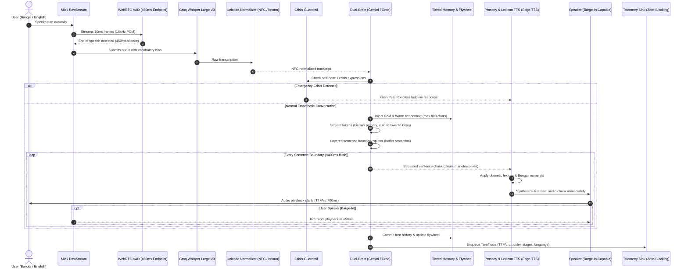

# 🌸 MAYA: Multilingual Voice AI Companion & IoT Gateway

[](https://www.python.org/)
[](https://fastapi.tiangolo.com/)
[](https://groq.com/)
[](https://ai.google.dev/)
[](https://github.com/rany2/edge-tts)
[](https://opensource.org/licenses/MIT)

**MAYA (মায়া)** is a high-performance, emotionally intelligent, multilingual AI voice companion and IoT controller engineered for conversational, low-latency interaction in **Bangla (বাংলা)**, **English**, and code-mixed speech.

Built with a **Software-First & Voice-First** methodology, MAYA runs fully hands-free with Siri-grade turn-taking, multi-session isolation, dual-brain automatic failover, full-duplex acoustic barge-in interruption, and an on-device Bengali Unicode normalization pipeline.

---

## ✨ Key Capabilities

* ⚡ **Siri-Grade Turn-Taking & Endpointing:** Cut silence endpoint latency to **~450ms** (`VAD_ENDPOINT_MS=450`), achieving **≤ 700ms p50** end-to-end voice latency.
* 🛑 **Full-Duplex Barge-In Interruption:** Real-time microphone monitoring via `sounddevice.RawStream` interrupts playback within **< 50ms** when the user speaks.
* 🧠 **Dual-Brain Architecture with Circuit Breaker:**
  * **Primary:** Google Gemini 3.5 Flash-Lite (`gemini-3.5-flash-lite`) for deep empathy, reasoning, and zero-cost tokens.
  * **Secondary:** Groq LLaMA (`openai/gpt-oss-120b`) with sub-300ms time-to-first-token.
  * **Automatic Failover & Circuit Breaker:** 3-failure sliding window with 60-second cooldown and mid-stream failover.
* ✂️ **Layered Streaming Sentence Boundary Engine:**
  * In-flight buffer protection prevents premature sentence splitting on decimals (`3.14`, `৩.১৪`), abbreviations (`Dr.`, `e.g.`), and URLs.
  * Zero-drop opening filler scrubber removes robotic openers (`"Sure!"`, `"Great question"`) without skipping subsequent sentences.
  * 400ms timeout flush guarantees speech synthesis never stalls.
* 🇧🇩 **Bangla Unicode Normalization & TTS Lexicon:**
  * Full token-level `bnunicodenormalizer` and NFC canonical composition eliminates multi-byte encoding mismatches.
  * Curated phonetic lexicon for Edge-TTS (`ডেডলক` $\to$ `ডেড-লক`, `রিসেট` $\to$ `রি-সেট`).
  * Automatic ASCII-to-Bengali numeral transliteration (`2.5` $\to$ `২.৫`).
* 🎙️ **Decoupled Prosody Engine (Pace & Expressivity):**
  * Independent **Pace multiplier** (`VOICE_PACE: 0.8–1.2×`) controlling speaking rate.
  * Independent **Expressivity pitch contour** (`VOICE_EXPRESSIVITY: low, medium, high`) modulating resonance.
  * Neural voice profiles: `bn-BD-NabanitaNeural` (Bangla) & `en-US-AvaNeural` (English).
* 💾 **Tiered Memory with Contradiction Resolution:**
  * **Hot Tier:** Verbatim rolling multi-turn history.
  * **Warm Tier:** Background summarized context bullets.
  * **Cold Tier:** Persistent disk memory (`server/data/user_memory.json`) with contradiction resolution, audit history, and an 800-character budget cap.
* 🔄 **Continuous Correction Flywheel:**
  * Listens for acoustic and terminology corrections (e.g. *"এটা ঢাকা, ঢাক্কা না"*, *"It's X, not Y"*).
  * Automatically appends entries to `server/data/correction_flywheel.jsonl` for ongoing model tuning.
* 👥 **Multi-Session Isolation:**
  * Concurrency-safe `SessionState` keyed by `session_id`. Each session maintains independent history, language tracking, and warm context.
* 📊 **Zero-Blocking Telemetry Sink & SLO Dashboard:**
  * Thread-safe `TurnTrace` queue with 50MB rolling file rotation (`server/data/traces.jsonl`).
  * Real-time SLO dashboard measuring TTFA p50/p95, fallback rates, and language breakdown (`python -m server.app.dashboard`).
* 🚨 **Deterministic Crisis Guardrail:** Zero-latency emergency safety interceptor for self-harm and acute distress expressions across Bangla, English, and Banglish, routing to *Kaan Pete Roi* helpline: `01779-554391`.

---

## 🏗️ System Architecture



---

## 🚀 Quick Start on Windows

### 1. One-Click Launch (Recommended)
Double-click **`run_windows.bat`** in the project root folder.
* Press **`[ENTER]`** to choose **Hands-Free Voice Mode**.
* Speak naturally in Bangla or English — zero keyboard presses needed!

### 2. Manual CLI Setup

1. **Clone the repository:**
   ```bash
   git clone https://github.com/fahadrahman444/maya-multilingual-voice-iot.git
   cd maya-multilingual-voice-iot
   ```

2. **Set up virtual environment:**
   ```powershell
   python -m venv venv
   .\venv\Scripts\Activate.ps1
   pip install -r server/requirements.txt
   ```

3. **Configure API Keys:**
   Copy `server/.env.example` to `server/.env`:
   ```powershell
   copy server\.env.example server\.env
   ```
   Add your API keys:
   * **GROQ_API_KEY**: [Groq Console](https://console.groq.com/keys) (Whisper STT & Fallback Brain)
   * **GEMINI_API_KEY**: [Google AI Studio](https://aistudio.google.com/app/apikey) (Primary Brain)

4. **Run the Assistant:**
   ```powershell
   python server/run_assistant.py
   ```

5. **View SLO & Telemetry Dashboard:**
   ```powershell
   python -m server.app.dashboard
   ```

---

## 🧪 Automated Test Suites

MAYA includes an extensive automated test suite covering all layers of the voice pipeline:

```powershell
# 1. Run Comprehensive Regression Suite (19/19 Verified End-to-End Tests)
python server/tests/test_regression.py

# 2. Run Telemetry Sink & Memory Persistence Tests
pytest server/tests/test_telemetry.py server/tests/test_memory.py

# 3. Test Bilingual Speech Synthesis (TTS) & Transcription (STT)
python server/tests/test_speech.py
```

---

## 📁 Repository Structure

```text
maya-multilingual-voice-iot/
├── run_windows.bat               # One-click Windows root launcher
├── TESTING_WINDOWS.md            # Windows testing & troubleshooting guide
├── Component.md                  # Hardware BOM & GPIO pinout specification
├── Workflow.md                   # End-to-end data transmission architecture
├── WorkingProcess.md             # Development roadmap & milestone tracker
├── server/
│   ├── run_assistant.py          # Interactive PC voice runner (VAD + Barge-in)
│   ├── requirements.txt          # Python dependencies
│   ├── .env.example              # Environment configuration template
│   ├── data/
│   │   ├── user_memory.json      # Persistent Cold-tier memory
│   │   ├── traces.jsonl          # Telemetry JSONL sink (50MB rolling)
│   │   └── correction_flywheel.jsonl # Continuous acoustic correction log
│   ├── app/
│   │   ├── config.py             # Settings validator & environment loader
│   │   ├── dashboard.py          # Real-time SLO calculation & dashboard CLI
│   │   └── pipeline/
│   │       ├── bengali.py        # Bangla Unicode normalizer & phonetic lexicon
│   │       ├── brain.py          # Dual-Brain engine, layered splitter, sessions
│   │       ├── memory.py         # Tiered memory store & contradiction resolver
│   │       ├── safety.py         # Zero-latency mental health crisis guardrail
│   │       ├── stt.py            # Groq Whisper Large V3 with dynamic context bias
│   │       ├── telemetry.py      # Zero-blocking TurnTrace queue & rotation sink
│   │       └── tts.py            # Decoupled prosody & markdown-free speech synthesizer
│   └── tests/
│       ├── test_regression.py    # 19-test full-pipeline regression suite
│       ├── test_telemetry.py     # Telemetry sink & dashboard tests
│       ├── test_memory.py        # Persistent memory unit tests
│       ├── test_speech.py        # Bilingual STT & TTS pipeline tests
│       └── test_brain.py         # Brain, greeting & crisis safety tests
```

---

## 🔒 Safety & Mental Health Disclaimer

MAYA is an empathetic voice assistant and conversational companion designed to promote daily calm, active listening, and mental wellness. **MAYA is not a medical device and does not provide psychiatric diagnoses or replace qualified healthcare professionals.**

For acute psychological distress, MAYA immediately routes users to verified mental health resources:
* **Bangladesh Helpline:** *Kaan Pete Roi (কান পেতে রই)*: `+880 1779-554391` / `+880 1779-554392`
* **National Emergency:** `999` (Bangladesh)

---

## 📄 License
This project is licensed under the [MIT License](LICENSE).
