# 🌸 MAYA: Multilingual Voice AI Companion & IoT Gateway

[](https://www.python.org/)
[](https://fastapi.tiangolo.com/)
[](https://groq.com/)
[](https://github.com/rany2/edge-tts)
[](https://opensource.org/licenses/MIT)

**MAYA (মায়া)** is an emotionally intelligent, multilingual AI voice companion and IoT controller tailored for low-latency voice interaction in both **Bangla (বাংলা)** and **English**. 

Engineered with a **Software-First & Voice-First** methodology, MAYA runs fully hands-free on your PC/laptop with zero button presses, providing compassionate active listening, real-time clock awareness, memory across restarts, and acute mental health crisis intervention.

---

## ✨ Key Capabilities

* 🎙️ **Hands-Free Continuous Voice Conversation:** Powered by WebRTC Voice Activity Detection (`webrtcvad`) with a comfortable 1.65-second silence tolerance, pre-roll buffering, and automatic echo suppression.
* 🌐 **Bilingual Fluency & Auto Language Detection:** Fluidly recognizes and speaks in both standard Bangla and English, seamlessly handling natural code-switching.
* 🧠 **Empathetic Cognitive Brain:** Powered by Groq Cloud ultra-fast LLMs with multi-turn memory, auto-summarization for long sessions, and real-time clock and calendar awareness.
* 🌸 **Soft & Alluring Neural Acoustic Profile:** Permanent voice modulation featuring a warm, gentle, velvety tone:
  * **Bangla:** `bn-BD-NabanitaNeural` (`pitch="-3Hz"`, `rate="-5%"`)
  * **English:** `en-US-AvaNeural` (`pitch="-2Hz"`, `rate="-5%"`)
* 💾 **Persistent Memory Across Restarts:** Remembers user facts, preferences, dynamic name changes, and verified entity corrections (e.g. *"Pizza Barg"*) stored in a dedicated local JSON store.
* 🚨 **Crisis Safety Guardrail:** Deterministic, zero-latency emergency intervention for suicide and self-harm expressions in Bangla, English, and Banglish, connecting users directly to Bangladesh's *Kaan Pete Roi* (কান পেতে রই) helpline: `01779-554391`.
* 🤝 **Islamic Salam Greeting & "Boss" Persona:** Exclusively greets with *"আসসালামু আলাইকুম"* / *"ওয়ালাইকুম আসসালাম"* and addresses the user respectfully as *"boss"*.

---

## 🏗️ System Architecture

```mermaid
sequenceDiagram
    autonumber
    actor User as User (Bangla / English)
    participant Edge as Mic / Edge Audio
    participant VAD as WebRTC VAD & RMS Filter
    participant STT as Groq Whisper Large V3
    participant Safety as Crisis Guardrail
    participant Brain as Cognitive Brain (Qwen/Gemini)
    participant Memory as Persistent Memory Store
    participant TTS as Neural Edge-TTS (Soft Profile)
    participant Speaker as Laptop Speakers / I2S Amp

    User->>Edge: Speaks query naturally
    Edge->>VAD: Streams 30ms PCM audio frames
    VAD-->>Edge: Detects speech & waits for 1.65s silence pause
    Edge->>STT: Submits 16kHz Mono PCM with vocabulary bias
    STT-->>Brain: Transcribed text (Bangla or English)
    
    Brain->>Safety: Check crisis risk (self-harm / suicide)
    alt Emergency Crisis Detected
        Safety-->>TTS: Kaan Pete Roi crisis helpline response
    else Normal Conversation
        Brain->>Memory: Load user facts, preferences & corrections
        Brain->>Brain: Auto-summarize older turns (if > 8 turns)
        Brain->>Brain: Inject real-time clock & "boss" persona
        Brain-->>TTS: 1-3 spoken conversational sentences
    end

    TTS->>Speaker: Synthesizes audio (Nabanita @ -3Hz / Ava @ -2Hz)
    Speaker->>User: Plays voice response through speakers
    Edge->>Edge: Software mic mute during playback (prevents echo)
    Edge->>User: Automatically resumes listening for your next turn
```



---

## 🚀 Quick Start on Windows

### 1. One-Click Launch (Recommended)
Simply double-click **`run_windows.bat`** in the project root folder.

* Press **`[ENTER]`** to choose **Hands-Free Voice Mode**.
* Speak naturally in Bangla or English into your microphone — zero keyboard presses needed!

### 2. Manual CLI Setup

1. **Clone the repository:**
   ```bash
   git clone https://github.com/fahadrahman444/maya-multilingual-voice-iot.git
   cd maya-multilingual-voice-iot
   ```

2. **Set up virtual environment:**
   ```powershell
   python -m venv venv
   .\venv\Scripts\Activate.ps1
   pip install -r server/requirements.txt
   ```

3. **Configure API Keys:**
   Copy `server/.env.example` to `server/.env`:
   ```powershell
   copy server\.env.example server\.env
   ```
   Add your free API keys:
   * **GROQ_API_KEY**: [Groq Console](https://console.groq.com/keys) (Whisper STT & LLM)
   * **GEMINI_API_KEY**: [Google AI Studio](https://aistudio.google.com/app/apikey)

4. **Run the Assistant:**
   ```powershell
   python server/run_assistant.py
   ```

---

## 🧪 Automated Test Suites

You can run automated unit tests independently without needing a physical microphone:

```powershell
# 1. Test Persistent Memory Store across simulated restarts
python server/tests/test_memory.py

# 2. Test Cognitive Brain, Real-Time Clock & Crisis Safety Guardrail
python server/tests/test_brain.py

# 3. Test Bilingual Speech Synthesis (TTS) & Transcription (STT)
python server/tests/test_speech.py
```

---

## 📁 Repository Structure

```text
maya-multilingual-voice-iot/
├── run_windows.bat               # One-click Windows root launcher
├── TESTING_WINDOWS.md            # Windows testing & troubleshooting guide
├── Component.md                  # Hardware BOM & GPIO pinout specification
├── Workflow.md                   # End-to-end data transmission architecture
├── WorkingProcess.md             # Development roadmap & milestone tracker
├── server/
│   ├── run_windows.bat           # Server folder Windows launcher
│   ├── run_assistant.py          # Interactive PC voice test runner (VAD)
│   ├── requirements.txt          # Python dependencies
│   ├── .env.example              # Environment configuration template
│   ├── data/
│   │   └── user_memory.json      # Persistent memory (facts, preferences, corrections)
│   ├── app/
│   │   ├── config.py             # Settings validator & environment loader
│   │   └── pipeline/
│   │       ├── brain.py          # Cognitive conversation engine & summarizer
│   │       ├── memory.py         # Persistent memory storage manager
│   │       ├── safety.py         # Zero-latency mental health crisis guardrail
│   │       ├── stt.py            # Groq Whisper Large V3 client with vocabulary bias
│   │       └── tts.py            # Edge-TTS synthesizer with Soft Female acoustic profile
│   └── tests/
│       ├── test_brain.py         # Brain, greeting & crisis safety tests
│       ├── test_memory.py        # Independent persistent memory unit tests
│       └── test_speech.py        # Bilingual STT & TTS pipeline tests
```

---

## 🔒 Safety & Mental Health Disclaimer

MAYA is an empathetic voice assistant and conversational companion designed to promote daily calm, active listening, and mental wellness. **MAYA is not a medical device and does not provide psychiatric diagnoses or replace qualified healthcare professionals.**

For acute psychological distress, MAYA immediately routes users to verified mental health resources:
* **Bangladesh Helpline:** *Kaan Pete Roi (কান পেতে রই)*: `+880 1779-554391` / `+880 1779-554392`
* **National Emergency:** `999` (Bangladesh)

---

## 📄 License
This project is licensed under the [MIT License](LICENSE).
