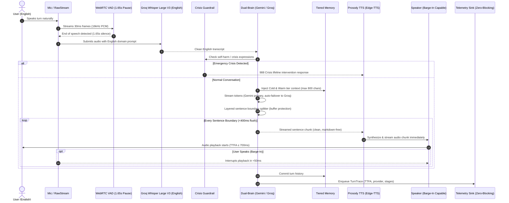

# 🌸 MAYA: Siri-Grade English Voice AI Companion & IoT Gateway

[](https://www.python.org/)
[](https://fastapi.tiangolo.com/)
[](https://groq.com/)
[](https://ai.google.dev/)
[](https://github.com/rany2/edge-tts)
[](https://opensource.org/licenses/MIT)

**MAYA** is a high-performance, emotionally intelligent, pure English AI voice companion and IoT controller engineered for natural, low-latency conversational interaction.

Built with a **Software-First & Voice-First** methodology, MAYA runs fully hands-free with Siri-grade turn-taking, multi-session isolation, dual-brain automatic failover, full-duplex acoustic barge-in interruption, and streaming speech synthesis.

---

## ✨ Key Capabilities

* 🎙️ **Hands-Free Continuous Voice Conversation:** Powered by WebRTC VAD with a comfortable **1.65-second silence tolerance** (`VAD_ENDPOINT_MS=1650`), allowing users to pause and think without being cut off.
* 🛑 **Full-Duplex Barge-In Interruption:** Real-time microphone monitoring via `sounddevice.RawStream` interrupts playback within **< 50ms** when the user speaks.
* 🧠 **Dual-Brain Architecture with Circuit Breaker:**
  * **Primary:** Google Gemini 3.5 Flash-Lite (`gemini-3.5-flash-lite`) for deep reasoning and zero-cost tokens.
  * **Secondary:** Groq LLaMA / Qwen (`qwen/qwen3.8-27b`) with sub-300ms time-to-first-token.
  * **Automatic Failover & Circuit Breaker:** 3-failure sliding window with 60-second cooldown and mid-stream failover.
* ⚡ **Ultra-Fast Whisper STT (Locked to English):**
  * Hardcoded English transcription (`language="en"`) bypasses language detection overhead, achieving **~150–250ms** transcription latency.
* ✂️ **Layered Streaming Sentence Boundary Engine:**
  * In-flight buffer protection prevents premature sentence splitting on decimals (`3.14`), abbreviations (`Dr.`, `e.g.`), and URLs.
  * Zero-drop opening filler scrubber removes robotic openers (`"Sure!"`, `"Great question"`) without skipping subsequent sentences.
  * 400ms timeout flush guarantees speech synthesis never stalls.
* 🎙️ **Decoupled Prosody Engine (Pace & Expressivity):**
  * Independent **Pace multiplier** (`VOICE_PACE: 0.8–1.2×`) controlling speaking rate.
  * Independent **Expressivity pitch contour** (`VOICE_EXPRESSIVITY: low, medium, high`) modulating resonance.
  * Neural voice profile: `en-US-AvaNeural` (English).
* 💾 **Tiered Memory with Contradiction Resolution:**
  * **Hot Tier:** Verbatim rolling multi-turn history.
  * **Warm Tier:** Background summarized context bullets.
  * **Cold Tier:** Persistent disk memory (`server/data/user_memory.json`) with contradiction resolution, audit history, and an 800-character budget cap.
* 👥 **Multi-Session Isolation:**
  * Concurrency-safe `SessionState` keyed by `session_id`. Each session maintains independent history and warm context.
* 📊 **Zero-Blocking Telemetry Sink & SLO Dashboard:**
  * Thread-safe `TurnTrace` queue with 50MB rolling file rotation (`server/data/traces.jsonl`).
  * Real-time SLO dashboard measuring TTFA p50/p95 and fallback rates (`python -m server.app.dashboard`).
* 🚨 **Deterministic Crisis Guardrail:** Zero-latency emergency safety interceptor for self-harm and acute distress expressions, routing to confidential crisis lifelines (`988`).
* 🤖 **Interactive Tabletop Robot Body:**
  * 2-DOF Pan-Tilt neck mechanism (2× MG90S metal-gear servos) for physical head nodding, shaking, and curious cocking.
  * 0.96" I²C OLED (SSD1306) display for real-time animated eye expressions (blinking, listening, happy, confused).
  * ESP32-S3 GPIO Terminal Expansion Board ensuring vibration-proof screw-locked wiring. Complete prototype BOM (~৳4,238 BDT) documented in **[Component.md](Component.md)**.

---

## 🏗️ System Architecture



---

## 🚀 Quick Start on Windows

### 1. One-Click Launch (Recommended)
Double-click **`run_windows.bat`** in the project root folder.
* Press **`[ENTER]`** to choose **Hands-Free Voice Mode**.
* Speak naturally in English — zero keyboard presses needed!

### 2. Manual CLI Setup

1. **Activate virtual environment:**
   ```powershell
   .\venv\Scripts\Activate.ps1
   pip install -r server/requirements.txt
   ```

2. **Configure API Keys:**
   Copy `server/.env.example` to `server/.env`:
   ```powershell
   copy server\.env.example server\.env
   ```
   Add your API keys:
   * **GROQ_API_KEY**: [Groq Console](https://console.groq.com/keys) (Whisper STT & Fallback Brain)
   * **GEMINI_API_KEY**: [Google AI Studio](https://aistudio.google.com/app/apikey) (Primary Brain)

3. **Run the Assistant:**
   ```powershell
   python server/run_assistant.py
   ```

4. **Run Regression Tests:**
   ```powershell
   python server/tests/test_regression.py
   ```
