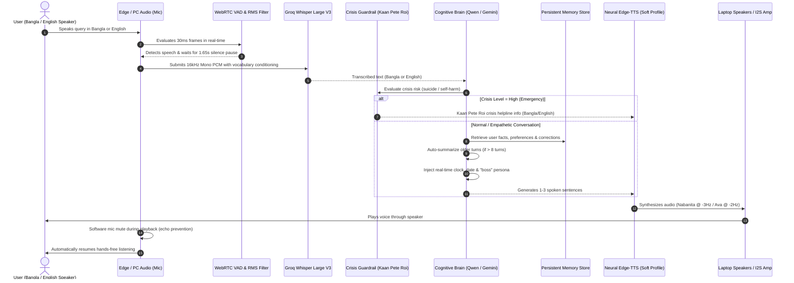

# MAYA: System Workflow & Technical Architecture

This document specifies the operational and data transmission workflow of **MAYA** (Alternative 2: ESP32-S3 Edge + FastAPI Gateway Server + Modular AI Pipeline).

---

## 1. End-to-End System Workflow

---

## 2. Technical Component Workflows

### A. Continuous Hands-Free Audio Ingestion & VAD
* **Sampling:** 16kHz, 16-bit Mono PCM.
* **WebRTC VAD:** Runs with forgiving aggressiveness (`mode=1`) combined with an RMS audio energy floor (`180.0`) to avoid dropping quiet syllables.
* **Pre-Roll Buffering:** Captures a 450ms audio ring buffer so the very first sound of a word is never clipped.
* **Comfortable Pause Tolerance:** Sustains listening across natural pauses, only concluding a turn after **1.65 seconds of silence**.

### B. Bilingual Speech Recognition (STT) Layer
* **Model:** Groq Cloud Whisper Large V3.
* **Dynamic Language Detection:** Automatically identifies whether the user is speaking Bangla, English, or code-mixed Banglish.
* **Prompt Conditioning:** Dynamically injects common conversational vocabulary and confirmed user corrections from memory to prevent phonetic distortion.

### C. Cognitive Brain with Auto-Summarization & Memory
* **Language Matching:** Flawlessly responds in the language spoken by the user.
* **Dynamic Time Awareness:** Real-time clock and calendar injected into every turn.
* **Context Auto-Summarization:** When history exceeds 8 turns, older context is compressed into running bullet points, preserving facts across indefinite turns.
* **Persistent Memory:** Remembers user facts, preferences, and entity corrections (e.g. *"Pizza Barg"*) across restarts.
* **Salam-Exclusive Greeting:** Uses *"আসসালামু আলাইকুম"* / *"ওয়ালাইকুম আসসালাম"* exclusively for Bengali greetings.

### D. Soft / Alluring Acoustic Speech Synthesis (TTS)
* **Bangla:** `bn-BD-NabanitaNeural` modulated at `pitch="-3Hz"`, `rate="-5%"`.
* **English:** `en-US-AvaNeural` modulated at `pitch="-2Hz"`, `rate="-5%"`.
* **Echo Protection:** Microphone stream is closed during speaker output so MAYA never hears herself.
