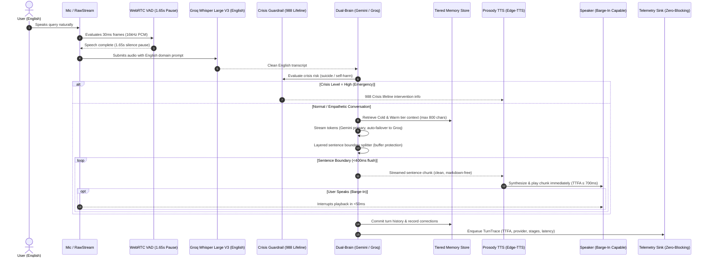

# MAYA: System Workflow & Technical Architecture

This document specifies the operational and data transmission workflow of **MAYA** (English Voice AI Assistant + IoT Gateway).

---

## 1. End-to-End System Workflow

---

## 2. Technical Component Workflows

### A. Continuous Hands-Free Audio Ingestion, VAD & Barge-In
* **Audio Format:** 16kHz, 16-bit Mono PCM.
* **Pause Tolerance:** WebRTC VAD (`mode=1`), 360ms pre-roll audio ring buffer, and **1.65s silence pause threshold** (`VAD_ENDPOINT_MS=1650`) allowing natural pauses without premature interruption.
* **Full-Duplex Barge-In Interruption:** Uses `sounddevice.RawStream` to simultaneously read incoming mic energy. If voice energy exceeds `BARGE_IN_RMS_THRESHOLD` while TTS is speaking, playback terminates in **< 50ms**, returning immediately to active listening.

### B. High-Speed English Speech Recognition (STT)
* **Model:** Groq Cloud Whisper Large V3 (`whisper-large-v3`) hardcoded with `language="en"`.
* **Latency Optimization:** Hardcoding English eliminates language identification overhead, achieving **~150–250ms** transcription latency.
* **Dynamic Conditioning:** Injects confirmed user corrections from memory to bias STT accuracy on domain terms.

### C. Cognitive Dual-Brain Engine
* **Primary Model:** Google Gemini 3.5 Flash-Lite (`gemini-3.5-flash-lite`).
* **Secondary Model:** Groq (`qwen/qwen3.8-27b`).
* **Circuit Breaker:** Sliding window skips failing primary on 3 consecutive errors for 60 seconds.
* **Layered Sentence Boundary Splitter:**
  * In-flight buffer protection preserves decimals (`3.14`), abbreviations (`Dr.`, `e.g.`), and URLs across streaming chunk boundaries.
  * Zero-drop opening filler scrubber removes robotic openers (`"Sure!"`, `"Great question"`) without skipping subsequent sentences.
  * 400ms timeout flush guarantees speech synthesis never stalls on long clauses.
* **Session Isolation:** `SessionState` keyed by `session_id` guarantees multi-user concurrency without history contamination.

### D. Prosody Engine & Neural Speech Synthesis (TTS)
* **Decoupled Controls:**
  * **Pace:** Multiplier (`0.8–1.2×`) independently adjusting speaking speed.
  * **Expressivity:** Pitch modulation (`-3Hz` to `+0Hz`) adjusting conversational resonance.
* **Neural Voice Profile:** `en-US-AvaNeural`.
* **Markdown Sanitizer:** Strips `**`, `*`, `` ` ``, `#` before audio synthesis.

### E. Tiered Memory Architecture
* **Hot Tier:** Last 6 verbatim conversational turns.
* **Warm Tier:** Background summarized context bullets.
* **Cold Tier:** Persistent disk store (`server/data/user_memory.json`) with contradiction resolution and prompt budget cap (800 chars / ~200 tokens).

### F. Zero-Blocking Telemetry & SLO Dashboard
* **TurnTrace Architecture:** Non-blocking queue (`queue.Queue`) offloaded to a background thread writer.
* **Log Rotation:** 50MB rolling file rotation (`server/data/traces.jsonl`).
* **SLO Dashboard:** Computes TTFA p50/p95 and fallback rates (`python -m server.app.dashboard`).
