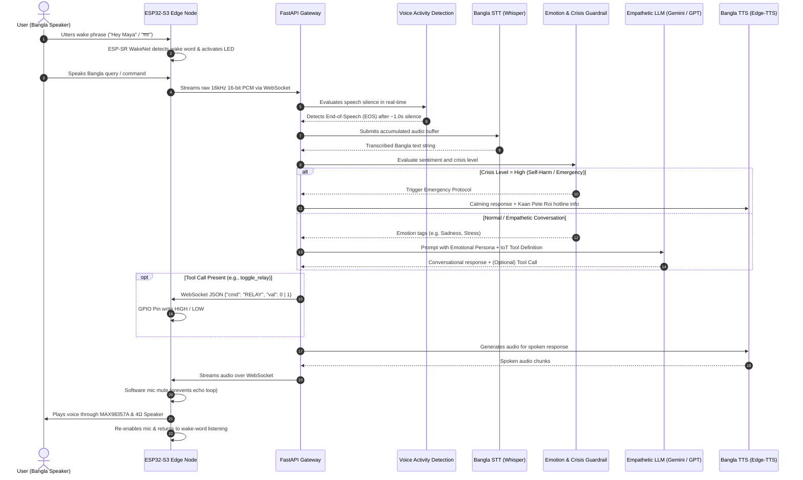

# MAYA: System Workflow & Technical Architecture

This document specifies the operational and data transmission workflow of **MAYA** (Alternative 2: ESP32-S3 Edge + FastAPI Gateway Server + Modular AI Pipeline).

---

## 1. End-to-End System Workflow

The complete interaction cycle operates in 7 sequential steps:



---

## 2. Technical Component Workflows

### A. Audio Ingestion & Network Transport
* **Microphone Sampling:** The INMP441 captures audio at $16\text{ kHz}$, 16-bit, Mono PCM format over the $I^2S$ protocol.
* **Voice Command Wake-Up (Edge ESP-SR):** The ESP32-S3 continuously runs an on-chip WakeNet neural model tuned for the wake phrase (*"Hey Maya"* / *"মায়া"*). The microphone streams locally into the wake detector without transmitting over the network.
* **Buffering & Transmission:** Upon wake-word detection, the ESP32 illuminates a status LED, emits an acknowledgment tone, and begins streaming 512-byte raw PCM audio packets over a persistent Wi-Fi WebSocket:
  ```
  ws://<SERVER_IP>:8000/ws/audio
  ```
* **Voice Activity Detection (VAD) & End-of-Speech:** The FastAPI Gateway runs Silero-VAD in real time on the incoming PCM chunks. When a user finishes speaking and silence is sustained for $\ge 1.0\text{ second}$, the server automatically marks End-of-Speech (EOS) and initiates the STT stage.

---

### B. Speech Recognition (STT) Layer
* The server collects the accumulated PCM stream and feeds it into the STT model (Groq Whisper or local Faster-Whisper with Bangla language code `language="bn"`).
* Text post-processing standardizes Bengali numerals, common punctuation, and phonetic transliterations.

---

### C. Mental Wellness & Crisis Safety Engine
To fulfill MAYA's mission as an empathetic companion and depression support assistant, all recognized text passes through an active safety triage pipeline:

1. **High-Risk Crisis Screening (Deterministic Regex & Keyword Detection):**
   * Scans for indicators of suicidal ideation, severe self-harm, or despair in both Bangla and Banglish (e.g., *"বেঁচে থাকার কোনো অর্থ নেই"*, *"আত্মহত্যা"*, *"মরে যেতে ইচ্ছে করছে"*).
   * **Action:** Overrides normal LLM generation with a predefined psychiatric crisis response:
     > *"আমি বুঝতে পারছি আপনার এই মুহূর্তটি অত্যন্ত কষ্টের। অনুগ্রহ করে একা থাকবেন না। আপনি কান পেতে রই (Kaan Pete Roi) হেল্পলাইনে কথা বলতে পারেন: ০১৭৭৯-৫৫৪৩৯১ / ০১৭৭৯-৫৫৪৩৯২। তারা আপনার পাশে আছেন।"*
2. **Empathetic Conversational Reasoning:**
   * When no acute danger is present, the LLM receives a customized system prompt instructing it to respond as a compassionate, calm companion:
     * Reflective active listening.
     * Validating the user's emotional experience without giving clinical prescriptions.
     * Encouraging small grounding actions (taking deep breaths, resting, drinking water).

---

### D. IoT Smart Home Actuation
MAYA controls physical home devices via native LLM Function Calling:

1. **Tool Definition Schema:**
   ```json
   {
     "name": "control_home_appliance",
     "description": "Switches connected home appliances on or off",
     "parameters": {
       "type": "object",
       "properties": {
         "device": { "type": "string", "enum": ["light", "fan"] },
         "state": { "type": "string", "enum": ["on", "off"] }
       },
       "required": ["device", "state"]
     }
   }
   ```
2. **Command Dispatch:**
   When invoked, the server emits a lightweight command to the ESP32:
   ```json
   {
     "event": "hardware_action",
     "target": "relay_1",
     "state": 1
   }
   ```
3. **Execution:** The ESP32 parses the JSON packet and executes `digitalWrite(RELAY_PIN, HIGH/LOW)`.

---

### E. Speech Synthesis (TTS) & Playback
1. The text reply is sent to the TTS engine using neural Bangla voices:
   * Engine: Microsoft Edge TTS
   * Voice Profile: `bn-BD-PradeepNeural` (Male) or `bn-BD-NabanitaNeural` (Female).
2. The generated audio stream is fed to the ESP32-S3 over the WebSocket in chunks.
3. The ESP32 feeds the samples to the **MAX98357A** I²S DAC/amplifier, driving the **4 Ω, 3 W speaker**.

---

## 3. Resilience, Offline Fallback & Interruption

| Condition | System Behavior |
|---|---|
| **Internet Outage** | The ESP32 detects server unreachable state. The optional tactile button on GPIO 11 falls back to local direct relay toggling. An offline chime alerts the user. |
| **User Interruption** | If the user utters the wake phrase or presses the manual override button while the speaker is playing, the ESP32 immediately dumps the MAX98357A DMA audio buffer and restarts listening. |
| **Acoustic Echo & Feedback** | Prevented by firmware-level software half-duplex muting: the ESP32 mutes the INMP441 microphone stream whenever the MAX98357A speaker amplifier is actively reproducing speech audio. |
