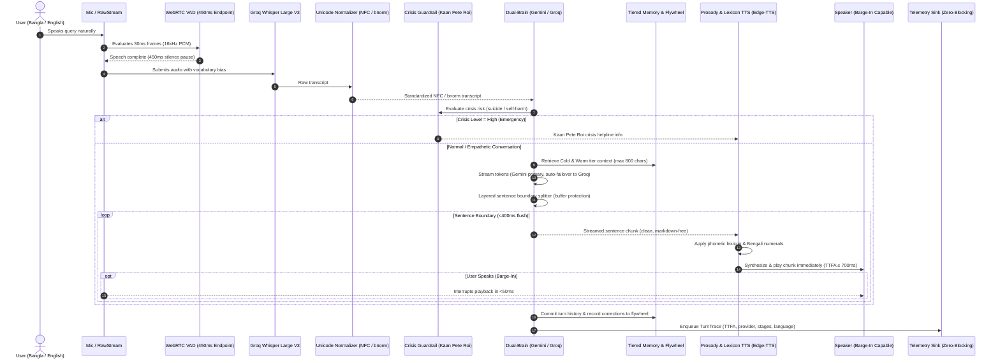

# MAYA: System Workflow & Technical Architecture

This document specifies the operational and data transmission workflow of **MAYA** (Alternative 2: ESP32-S3 Edge + FastAPI Gateway Server + Modular AI Pipeline).

---

## 1. End-to-End System Workflow

---

## 2. Technical Component Workflows

### A. Siri-Grade Audio Ingestion, VAD & Barge-In
* **Audio Format:** 16kHz, 16-bit Mono PCM.
* **Siri-Grade Endpointing:** WebRTC VAD (`mode=1`), 360ms pre-roll audio ring buffer, and **450ms silence pause threshold** (`VAD_ENDPOINT_MS=450`).
* **Full-Duplex Barge-In Interruption:** When enabled, audio playback uses `sounddevice.RawStream` to simultaneously read incoming mic energy. If voice energy exceeds `BARGE_IN_RMS_THRESHOLD` (420.0 RMS) while TTS is speaking, playback terminates in **< 50ms**, returning immediately to active listening.

### B. Bilingual Speech Recognition & Unicode Normalization
* **Model:** Groq Cloud Whisper Large V3 (`whisper-large-v3`).
* **Dynamic Conditioning:** Injects confirmed user corrections from memory to bias STT accuracy on domain terms.
* **Bengali Unicode Normalization:** Runs `unicodedata.normalize('NFC')` and `bnunicodenormalizer` to eliminate multi-byte encoding mismatches and prevents hallucinated tokens.

### C. Cognitive Dual-Brain Engine
* **Primary Model:** Google Gemini 3.5 Flash-Lite (`gemini-3.5-flash-lite`).
* **Secondary Model:** Groq LLaMA (`openai/gpt-oss-120b`).
* **Circuit Breaker:** Sliding window skips failing primary on 3 consecutive errors for 60 seconds.
* **Layered Sentence Boundary Splitter:**
  * In-flight buffer protection preserves decimals (`3.14`, `৩.১৪`), titles (`Dr.`), and URLs across streaming chunk boundaries.
  * Zero-drop opening filler scrubber removes robotic openers (`"Sure!"`, `"Great question"`) without skipping subsequent sentences.
  * 400ms timeout flush guarantees speech synthesis never stalls on long clauses.
* **Session Isolation:** `SessionState` keyed by `session_id` guarantees multi-user concurrency without history contamination.

### D. Prosody Engine & Neural Speech Synthesis (TTS)
* **Decoupled Controls:**
  * **Pace:** Multiplier (0.8–1.2×) independently adjusting speaking speed.
  * **Expressivity:** Pitch modulation (`-3Hz` to `+0Hz`) adjusting conversational resonance.
* **Phonetic Lexicon:** Replaces problematic loan words with phonetic spellings (`ডেডলক` $\to$ `ডেড-লক`).
* **Numeral Conversion:** Translates ASCII digits to Bengali numerals (`2.5` $\to$ `২.৫`) in Bangla turns to prevent acoustic glitches.
* **Markdown Sanitizer:** Strips `**`, `*`, `` ` ``, `#` before audio synthesis.

### E. Tiered Memory & Continuous Correction Flywheel
* **Hot Tier:** Last 6 verbatim conversational turns.
* **Warm Tier:** Background summarized context bullets.
* **Cold Tier:** Persistent disk store (`server/data/user_memory.json`) with contradiction resolution and prompt budget cap (800 chars / ~200 tokens).
* **Correction Flywheel:** Logs confirmed user corrections into `server/data/correction_flywheel.jsonl`.

### F. Zero-Blocking Telemetry & SLO Dashboard
* **TurnTrace Architecture:** Non-blocking queue (`queue.Queue`) offloaded to a background thread writer.
* **Log Rotation:** 50MB rolling file rotation (`server/data/traces.jsonl`).
* **SLO Dashboard:** Computes TTFA p50/p95, fallback rates, and language breakdown (`python -m server.app.dashboard`).
