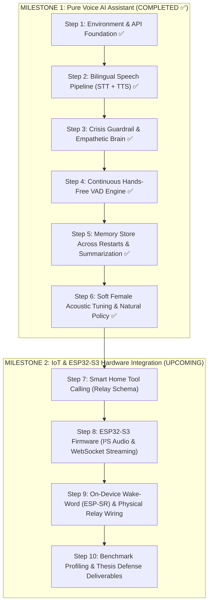

# MAYA: Complete Step-by-Step Engineering Working Process

This document serves as the master engineering guide and operational roadmap for developing **MAYA (Multilingual Bangla AI Voice Assistant & IoT Controller)**.

It follows a **Software-First & Voice-First Strategy**: building and thoroughly verifying the complete conversational speech, memory, and safety pipeline directly on your computer before introducing smart-home relay controls and embedded ESP32-S3 hardware.

---

## 1. Project Development Roadmap



---

## 2. Milestone 1: Pure Voice AI Assistant (Verified Status: ✅ Complete)

### Step 1: Environment, Configuration & Foundation (Completed ✅)
* Lightweight package requirements in `server/requirements.txt`.
* Environment configuration loader with validation in `server/app/config.py`.
* One-click Windows launchers created at both project root (`run_windows.bat`) and `server/run_windows.bat`.

### Step 2: Bilingual Speech Pipeline (STT & TTS) (Completed ✅)
* **STT:** Groq Whisper Large V3 with dynamic language identification (Bangla, English, and code-mixed) and vocabulary conditioning in `server/app/pipeline/stt.py`.
* **TTS:** Microsoft Edge-TTS with language-based voice auto-switching in `server/app/pipeline/tts.py`.
* **Verification:** Verified with `server/tests/test_speech.py` achieving <1.0s synthesis and <1.0s transcription.

### Step 3: Crisis Guardrail & Cognitive Brain (Completed ✅)
* **Safety:** Zero-latency deterministic regex detector for self-harm and suicide crisis phrases in both Bangla and English in `server/app/pipeline/safety.py`. Connects users directly to *Kaan Pete Roi* mental health helpline.
* **Brain:** Qwen 3.8 27B / Gemini 2.0 Flash engine with dynamic real-time clock and calendar in `server/app/pipeline/brain.py`.
* **Greetings:** Strict Salam-only policy (*"আসসালামু আলাইকুম"* / *"ওয়ালাইকুম আসসালাম"*) and natural *"boss"* address.

### Step 4: Continuous Hands-Free VAD Engine (Completed ✅)
* Seamless hands-free voice conversation with zero key presses in `server/run_assistant.py`.
* WebRTC VAD (`mode=1`), 450ms pre-roll audio ring buffer, RMS floor (`180.0`), and **1.65-second silence pause tolerance** to prevent premature interruption.
* Automatic software mic mute during playback to prevent echo loops.

### Step 5: Persistent Memory Store & History Summarization (Completed ✅)
* **Memory Store:** Atomic JSON store in `server/app/pipeline/memory.py` saving user facts, preferences, and verified corrections across process restarts (`server/data/user_memory.json`).
* **Correction Tracking:** Automatically extracts and respects corrections (e.g. *"Pizza Barg"*).
* **Auto-Summarization:** Summarizes older turns when history exceeds 8 exchanges, preserving context indefinitely.
* **Verification:** Verified with independent test suite `server/tests/test_memory.py`.

### Step 6: Soft / Alluring Female Acoustic Tuning (Completed ✅)
* Modulated pitch and speech rate in `server/app/pipeline/tts.py`:
  * Bangla: `bn-BD-NabanitaNeural` (`pitch="-3Hz"`, `rate="-5%"`)
  * English: `en-US-AvaNeural` (`pitch="-2Hz"`, `rate="-5%"`)
* Natural conversation policy: Maya does not force trailing questions every turn; she reacts, validates, and converses organically.

---

## 3. Automated Test Commands

```powershell
# 1. Test Persistent Memory Store across restarts
python server/tests/test_memory.py

# 2. Test Cognitive Brain, Context & Crisis Safety Guardrail
python server/tests/test_brain.py

# 3. Test Bilingual Speech Synthesis (TTS) and Transcription (STT)
python server/tests/test_speech.py
```
