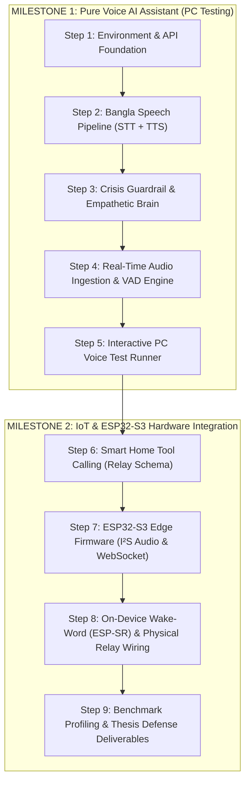

# MAYA: Complete Step-by-Step Engineering Working Process

This document serves as the master engineering guide and operational roadmap for developing **MAYA (Multilingual Bangla AI Voice Assistant & IoT Controller)**.

It follows a **Software-First & Voice-First Strategy**: building and thoroughly verifying the complete conversational Bangla speech and safety pipeline directly on your computer before introducing smart-home relay controls and embedded ESP32-S3 hardware.

---

## 1. Project Development Strategy



---

## 2. Milestone 1: Pure Voice AI Assistant (Tested on PC)

The goal of Milestone 1 is to achieve a low-latency, empathetic voice conversation system in Bangla without requiring any microcontrollers or breadboards.

### Step 1: Environment, Configuration & Foundation
* **Objective:** Establish an isolated, lightweight Python runtime and configuration loader optimized for the host system.
* **Deliverables:**
  - `server/requirements.txt`: Lightweight package specifications avoiding heavy local neural frameworks.
  - `server/.env.example` & `server/.env`: Templates for `GROQ_API_KEY` and `GEMINI_API_KEY`.
  - `server/app/config.py`: Pydantic/dataclass settings validator verifying required keys and network parameters.
* **Verification Command:**
  ```bash
  python3 -c "from server.app.config import settings; print('Config loaded successfully!')"
  ```
* **Success Criteria:** Zero dependency conflicts, clean virtual environment activation, and verified API key detection.

---

### Step 2: Bangla Speech Pipeline (STT & TTS)
* **Objective:** Build two-way audio conversion between spoken Bengali and clean text.
* **Deliverables:**
  - `server/app/pipeline/stt.py`: Groq Whisper API client configured for Bangla (`language="bn"`, `model="whisper-large-v3"`). Transcribes audio buffers to Bengali script in $\approx 300\text{ ms}$.
  - `server/app/pipeline/tts.py`: Microsoft Edge TTS client generating natural Bengali speech via `bn-BD-PradeepNeural` or `bn-BD-NabanitaNeural` and converting to standard 16kHz PCM audio.
  - `server/tests/test_speech.py`: Automated unit test for transcription and speech synthesis roundtrips.
* **Verification Command:**
  ```bash
  python3 server/tests/test_speech.py
  ```
* **Success Criteria:** Synthesizes an audio sample in $< 500\text{ ms}$, plays clear Bangla speech, and transcribes spoken Bangla with low Word Error Rate (WER $\le 18\%$).

---

### Step 3: Crisis Safety Guardrail & Empathetic Cognitive Brain
* **Objective:** Ensure user emotional well-being with CBT-aligned active listening and zero-latency suicide/self-harm protection.
* **Deliverables:**
  - `server/app/pipeline/safety.py`: Deterministic regex and phrase-matching engine for acute crisis keywords in Bangla & Banglish (e.g., *"বেঁচে থাকার ইচ্ছা নেই"*, *"আত্মহত্যা"*, *"মরে যেতে চাই"*). When triggered, overrides LLM generation and directly provides *Kaan Pete Roi* crisis contact info (*০১৭৭৯-৫৫৪৩৯১*).
  - `server/app/pipeline/brain.py`: Google Gemini 2.0 Flash client with customized system prompts enforcing warm, non-judgmental active listening, respectful Bangla honorifics (*"আপনি"*, *"আপনার"*), and multi-turn conversational memory.
  - `server/tests/test_brain.py`: Unit test suite covering conversational queries, emotional venting, and crisis trigger phrases.
* **Verification Command:**
  ```bash
  python3 server/tests/test_brain.py
  ```
* **Success Criteria:** 100% detection rate on emergency crisis phrases with zero delay, and warm, empathetic responses on non-crisis conversational inputs.

---

### Step 4: Real-Time Audio Streaming & VAD Engine
* **Objective:** Implement full-duplex WebSocket routing and automatic pause detection so users don't need manual buttons to signal end-of-speech.
* **Deliverables:**
  - `server/app/pipeline/vad.py`: Lightweight Voice Activity Detection (`webrtcvad` / energy-based thresholding) detecting user speech boundaries and identifying silence pauses ($\ge 1.0\text{ s}$) as End-of-Speech (EOS).
  - `server/app/main.py`: FastAPI server exposing WebSocket endpoint `ws://0.0.0.0:8000/ws/audio`. Routes raw PCM chunks through VAD $\rightarrow$ STT $\rightarrow$ Safety/Brain $\rightarrow$ TTS $\rightarrow$ audio response streaming.
* **Verification Command:**
  ```bash
  python3 server/tests/test_server.py
  ```
* **Success Criteria:** WebSocket accepts 16kHz 16-bit PCM chunks, automatically detects speech pauses, and streams synthesized Bangla audio back without memory leaks.

---

### Step 5: Interactive PC Voice Assistant Runner
* **Objective:** Enable a complete, live conversational experience directly on your computer.
* **Deliverables:**
  - `server/run_assistant.py`: Standalone CLI tool linking your computer's microphone and speakers to the FastAPI backend.
* **Operational Flow:**
  1. The user speaks in Bangla into the PC microphone.
  2. The runner streams audio to the server; VAD detects when speech ends.
  3. The server transcribes the utterance, passes it through the safety/brain layer, and generates speech.
  4. The synthesized response plays out loud through your PC speakers.
  5. The console displays a live latency breakdown (STT latency, LLM thinking time, TTS generation time).
* **Verification Command:**
  ```bash
  python3 server/run_assistant.py
  ```
* **Success Criteria:** Complete end-to-end voice roundtrip achieved with latency $\le 2.5\text{ seconds}$ and clear audible Bangla dialogue.

---

## 3. Milestone 2: IoT Actuation & ESP32-S3 Hardware Integration

Once Milestone 1 is verified on your PC, we connect the physical IoT hardware.

### Step 6: Smart Home Tool Calling (Relay Schema)
* **Objective:** Enable the cognitive engine to understand home automation intents and dispatch hardware commands.
* **Deliverables:**
  - `server/app/tools/relay.py`: Structured Gemini Function Calling definition (`control_home_appliance(device, state)`).
  - Server-side tool dispatcher emitting JSON commands: `{"event": "hardware_action", "target": "relay_1", "state": 1 | 0}`.
* **Success Criteria:** Commands like *"মায়া, লাইটটা অন করো"* trigger the function call and format the exact hardware payload.

---

### Step 7: ESP32-S3 Edge Firmware (I²S Audio & WebSocket)
* **Objective:** Program the ESP32-S3 microcontroller to stream microphone audio to the server and receive synthesized speech.
* **Deliverables:**
  - `firmware/platformio.ini`: ESP32-S3 configuration with octal PSRAM enabled.
  - `firmware/src/audio_i2s.cpp`: I²S driver for INMP441 digital microphone (GPIO 4, 5, 6) and MAX98357A amplifier (GPIO 7, 15, 16).
  - `firmware/src/ws_client.cpp`: Persistent Wi-Fi WebSocket client communicating with `ws://<SERVER_IP>:8000/ws/audio`.
* **Success Criteria:** Bidirectional raw 16kHz PCM audio streaming between the ESP32-S3 hardware and the FastAPI server over local Wi-Fi.

---

### Step 8: On-Device Wake Word (ESP-SR) & Physical Relay Wiring
* **Objective:** Enable hands-free voice wake-up and physical appliance switching.
* **Deliverables:**
  - `firmware/src/wake_word.cpp`: On-chip ESP-SR / WakeNet keyword spotter tuned for *"Hey Maya"* / *"মায়া"*.
  - `firmware/src/relay.cpp`: Actuates GPIO 10 to switch the optocoupled 5V relay module.
  - Software half-duplex mute: Disables microphone sampling while the speaker is actively playing to prevent acoustic feedback loops.
* **Success Criteria:** Saying *"Hey Maya"* wakes the device, voice commands actuate the 5V relay, and audio feedback loops are completely absent.

---

### Step 9: Benchmark Profiling & Thesis Defense Deliverables
* **Objective:** Quantitatively evaluate performance against capstone criteria.
* **Deliverables:**
  - `benchmarks/eval_metrics.py`: Benchmark runner evaluating:
    1. **End-to-End Latency:** $\le 2.5\text{ seconds}$.
    2. **STT Word Error Rate (WER):** $\le 18\%$ on 100 spoken Bangla commands.
    3. **Crisis Detection Recall:** $\ge 95\%$ on suicide/distress trigger phrases.
    4. **IoT Command Success Rate:** $\ge 95\%$ over 100 smart-home commands.
  - Demonstration scripts and presentation charts for thesis defense.

---

## 4. Hardware Resource Budget (Host Machine)

| Resource | Available on Host | Required by MAYA Gateway | Status |
|---|---|---|:---:|
| **CPU** | Intel Pentium G645 (2 Cores @ 2.90GHz) | $\approx 3\%\text{--}5\%$ during active audio streaming | **OK (Optimal)** |
| **RAM** | 3.7 GB (~914 MB free) | $\approx 80\text{--}120\text{ MB}$ total Python footprint | **OK (Optimal)** |
| **Storage** | 6.0 GB available | $< 150\text{ MB}$ (virtual environment & packages) | **OK (Optimal)** |
