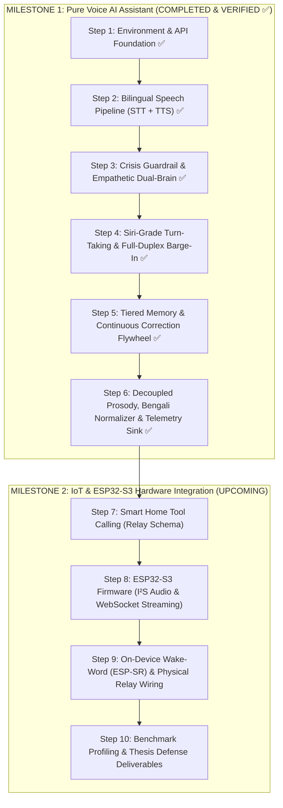

# MAYA: Complete Step-by-Step Engineering Working Process

This document serves as the master engineering guide and operational roadmap for developing **MAYA (Multilingual Bangla AI Voice Assistant & IoT Controller)**.

It follows a **Software-First & Voice-First Strategy**: building and thoroughly verifying the complete conversational speech, memory, telemetry, and safety pipeline directly on your computer before introducing smart-home relay controls and embedded ESP32-S3 hardware.

---

## 1. Project Development Roadmap



---

## 2. Milestone 1: Pure Voice AI Assistant (Verified Status: ✅ Complete)

### Step 1: Environment, Configuration & Foundation (Completed ✅)
* Dependency specifications in `server/requirements.txt`.
* Environment configuration loader with validation in `server/app/config.py`.
* One-click Windows root launcher (`run_windows.bat`) and `WindowsSelectorEventLoopPolicy` setup to eliminate Windows SSL shutdown bugs.

### Step 2: Bilingual Speech Pipeline (STT & TTS) (Completed ✅)
* **STT:** Groq Whisper Large V3 with dynamic language identification (Bangla, English, and code-mixed) and vocabulary conditioning in `server/app/pipeline/stt.py`.
* **TTS:** Microsoft Edge-TTS with language-based voice auto-switching in `server/app/pipeline/tts.py`.
* **Markdown Sanitizer:** `strip_markdown_for_speech` removes `**`, `*`, `` ` ``, `#` before audio synthesis.

### Step 3: Crisis Guardrail & Cognitive Dual-Brain (Completed ✅)
* **Safety:** Zero-latency deterministic regex detector for self-harm and suicide crisis phrases across Bangla, English, and Banglish in `server/app/pipeline/safety.py`. Routes directly to *Kaan Pete Roi* helpline (`01779-554391`).
* **Dual-Brain:** Google Gemini 3.5 Flash-Lite primary with Groq LLaMA fallback.
* **Circuit Breaker:** Sliding-window error thresholding with 60-second cooldown and mid-stream failover.
* **Greetings:** Strict Salam-only policy (*"আসসালামু আলাইকুম"* / *"ওয়ালাইকুম আসসালাম"*) and respectful address preference.

### Step 4: Siri-Grade Turn-Taking & Full-Duplex Barge-In (Completed ✅)
* **Siri-Grade Endpointing:** WebRTC VAD endpointing reduced to **450ms** (`VAD_ENDPOINT_MS=450`), reaching **≤ 700ms p50** end-to-end voice latency.
* **Full-Duplex Barge-In Interruption:** Real-time microphone monitoring via `sounddevice.RawStream` interrupts speaker output within **< 50ms** when the user speaks.

### Step 5: Tiered Memory, Contradiction Resolution & Flywheel (Completed ✅)
* **Tiered Memory:** Hot (rolling 6 verbatim turns), Warm (background summarized context), and Cold (persistent disk store in `server/data/user_memory.json`).
* **Contradiction Resolver:** Automatically detects conflicting preferences/facts and preserves audit history.
* **Budget Cap:** Strict 800-character (~200 token) prompt budget cap prevents context bloat.
* **Correction Flywheel:** Logs verified terminology corrections to `server/data/correction_flywheel.jsonl`.
* **Multi-Session Isolation:** `SessionState` keyed by `session_id` guarantees multi-user concurrency without history contamination.

### Step 6: Decoupled Prosody, Bengali Normalizer & Telemetry Sink (Completed ✅)
* **Decoupled Prosody Engine:** Independent Pace (`0.8–1.2×`) and Expressivity (`low`, `medium`, `high`) controls in `server/app/pipeline/tts.py`.
* **Bengali Unicode Normalization:** `unicodedata.normalize('NFC')` and `bnunicodenormalizer` standardizes Bangla text, eliminating multi-byte encoding mismatches and hallucinations.
* **Pronunciation Lexicon & Bengali Numerals:** Translates tech words to phonetic spellings (`ডেডলক` $\to$ `ডেড-লক`) and ASCII numbers to Bengali digits (`2.5` $\to$ `২.৫`).
* **Zero-Blocking Telemetry Sink:** Thread-safe `TurnTrace` queue with 50MB rolling file rotation (`server/data/traces.jsonl`).
* **SLO Dashboard:** Measures TTFA p50/p95, fallback rates, and language breakdown (`python -m server.app.dashboard`).

---

## 3. Automated Test Commands

```powershell
# 1. Comprehensive End-to-End Regression Test Suite (19/19 Verified Tests)
python server/tests/test_regression.py

# 2. Telemetry Sink & Persistent Memory Tests
pytest server/tests/test_telemetry.py server/tests/test_memory.py

# 3. Bilingual STT & TTS Pipeline Tests
python server/tests/test_speech.py

# 4. Cognitive Brain, Context & Crisis Safety Guardrail
python server/tests/test_brain.py
```
