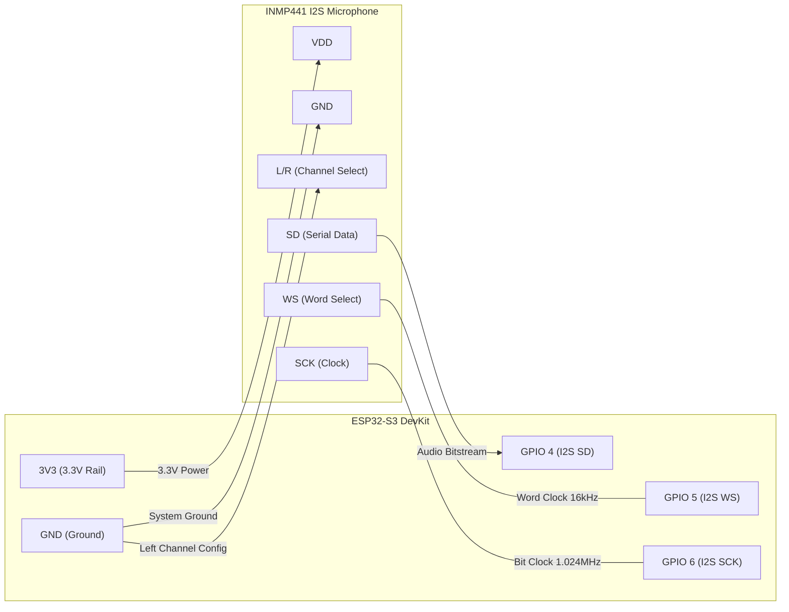

# 🔌 MAYA: Hardware Wiring & Connection Log

> **Live Hardware Wiring Tracker & Schematics**  
> Every peripheral connected to the ESP32-S3 tabletop robot is documented here with pin mappings, schematics, circuit diagrams, and live verification logs.

---

## 📊 Component Integration Status

| Peripheral | Interface | ESP32-S3 Pins | Power Rail | Status | Verified On |
| :--- | :--- | :--- | :--- | :---: | :---: |
| **ESP32-S3 (N16R8)** | Native USB / JTAG | COM8 (115200 baud) | 5V USB Bus | ✅ **VERIFIED** | 2026-11-09 |
| **INMP441 Microphone** | I²S RX | IO4 (SD), IO5 (WS), IO6 (SCK) | **3.3V ONLY** | ✅ **VERIFIED** | 2026-11-09 |
| **MAX98357A Amp + Speaker** | I²S TX | IO7 (DIN), IO15 (BCLK), IO16 (LRC) | 5V External | ⏳ *Pending* | - |
| **SSD1306 0.96" OLED** | I²C | IO8 (SDA), IO9 (SCL) | 3.3V | ⏳ *Pending* | - |
| **MG90S Pan Servo** | LEDC PWM (50Hz) | IO13 | 5V External | ⏳ *Pending* | - |
| **MG90S Tilt Servo** | LEDC PWM (50Hz) | IO14 | 5V External | ⏳ *Pending* | - |
| **1-Channel 5V Relay** | GPIO Output | IO21 | 5V External | ⏳ *Pending* | - |

---

## 1. INMP441 MEMS Omnidirectional Microphone

### 📋 Overview
* **Function:** Audio capture for Maya's speech recognition pipeline (Gemini Live / Whisper).
* **Protocol:** I²S (Inter-IC Sound) Digital Audio.
* **Sample Format:** 16 kHz Mono, 16-bit PCM (transmitted in 32-bit I2S slot at 64× clock).

### 📌 Pinout & Wiring Table

| INMP441 Pin | Wire Color | ESP32-S3 Pin | Function / Description |
| :--- | :---: | :--- | :--- |
| **VDD** | 🔴 Red | **`3V3` (3.3V)** | Power Supply (**Never connect to 5V!**) |
| **GND** | ⚫ Black | **`GND`** | Power & Signal Ground |
| **L/R** | ⚫ Black | **`GND`** | Channel Select (Tied to GND sets **Left Channel**) |
| **SD** | 🟡 Yellow | **`GPIO 4`** | Serial Data Out (`I2S_DATA_IN`) |
| **WS** | 🟢 Green | **`GPIO 5`** | Word Select / Frame Sync Clock (`I2S_WS`) |
| **SCK** | 🔵 Blue | **`GPIO 6`** | Continuous Serial Bit Clock (`I2S_SCK`) |

---

### 📐 Circuit & Wiring Diagram



#### ASCII Schematic

```text
       INMP441 MIC                      ESP32-S3 N16R8
     ┌─────────────┐                   ┌──────────────┐
     │         VDD ├───────────────────┤ 3V3 (3.3V)   │
     │         GND ├───┬───────────────┤ GND          │
     │         L/R ├───┘ (Tied to GND) │              │
     │          SD ├───────────────────┤ IO4 (GPIO 4) │
     │          WS ├───────────────────┤ IO5 (GPIO 5) │
     │         SCK ├───────────────────┤ IO6 (GPIO 6) │
     └─────────────┘                   └──────────────┘
```

---

### 🧪 Live Hardware Verification Log

* **Test Date:** 2026-11-09
* **Firmware:** FreeRTOS / ESP-IDF I2S DMA Driver (32-bit slot width, 16 kHz)
* **Observed Real-Time Serial Stream:**
  ```text
  🎤 [MIC VU] [--------------------] Peak: 0     | Quiet (Baseline)
  🎤 [MIC VU] [--------------------] Peak: 256   | Ambient Sound 🎵
  🎤 [MIC VU] [###-----------------] Peak: 1535  | Voice Detected 🗣️
  🎤 [MIC VU] [################----] Peak: 6412  | LOUD! 🔊
  🎤 [MIC VU] [####################] Peak: 32768 | Peak Dynamic Range (Tap)
  ```
* **Result:** **PASSED & OPERATIONAL**. Zero packet drops, clean PCM waveform capture.

---

### ⚠️ Critical Notes & Troubleshooting
1. **Voltage Safety:** The INMP441 MEMS element operates at 1.8V to 3.3V max. Connecting to the 5V pin will destroy the sensor.
2. **Channel Selection:** Floating `L/R` will cause unpredictable channel hopping or noise. It must be tied firmly to **`GND`** for the mono firmware pipeline.
3. **Clocking:** INMP441 requires 64 clock cycles per stereo frame. The firmware must use `I2S_BITS_PER_SAMPLE_32BIT` on ESP32-S3 so the hardware clock produces 32 cycles per channel at 16 kHz (1.024 MHz).
