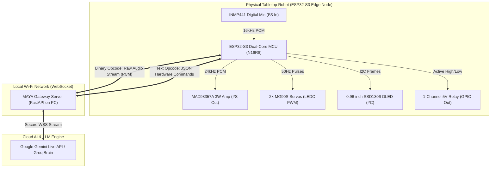

# 🤖 MAYA: ESP32-S3 IoT Hardware Architecture & Full Connection Guide
### Complete Electrical Pinouts, FreeRTOS Firmware, and FastAPI Gateway Bridge

---

## 1. System Topology & Communication Architecture

MAYA uses an **Edge–Gateway–Cloud Hybrid Architecture**. The ESP32-S3 acts as the sensory endpoint and physical actuator, while the PC/Laptop runs the FastAPI Gateway Server.



### Communication Protocol over Single WebSocket (`/ws/robot`)
To maximize throughput and eliminate protocol overhead, the connection uses a single multiplexed WebSocket:
1. **Binary Frames (Audio Data):**
   * **Upstream (Robot ➔ Gateway):** Continuous 16 kHz, 16-bit Mono raw PCM audio (32 bytes per 1ms, sent in 30ms / 960-byte chunks).
   * **Downstream (Gateway ➔ Robot):** 24 kHz (or 16 kHz), 16-bit Mono raw PCM audio chunks dispatched directly to the I²S DMA TX buffer.
2. **Text Frames (JSON Control & Telemetry):**
   * **Downstream Commands (Gateway ➔ Robot):**
     * Relay trigger: `{"action": "relay", "state": 1}`
     * Head servo motion: `{"action": "servo", "pan": 90, "tilt": 110, "speed": "smooth"}`
     * OLED Eye expression: `{"action": "oled", "expression": "listening"}`
     * Audio Buffer Flush (Barge-in): `{"action": "audio_flush"}`
   * **Upstream Telemetry (Robot ➔ Gateway):**
     * Boot status: `{"status": "ready", "mac": "...", "free_heap": 240000}`
     * Wake button press: `{"event": "button_press"}`

---

## 2. Complete Hardware Pinout & Wiring Matrix

The **ESP32-S3 N16R8** has 45 programmable GPIOs. To prevent boot failures, crashes, or interference with internal Octal PSRAM, pins are strictly partitioned.

> [!CAUTION]
> **Reserved Internal Pins:** Never use **GPIO 33, 34, 35, 36, 37** on the ESP32-S3 N16R8. They are internally hardwired to the Octal PSRAM/Flash. Connecting external peripherals to these pins will trigger immediate processor reboot loops (`Guru Meditation Error`).

```
                              ┌────────────────────────┐
                              │     ESP32-S3 N16R8     │
                     3.3V ────┤ 3V3                GND ├──── Common Ground
                      GND ────┤ GND                 5V ├──── 5V 3A Rail
          (I2S Mic SD) 04 ────┤ IO4                IO7 ├──── 07 (I2S Amp DIN)
          (I2S Mic WS) 05 ────┤ IO5               IO15 ├──── 15 (I2S Amp BCLK)
         (I2S Mic SCK) 06 ────┤ IO6               IO16 ├──── 16 (I2S Amp LRC)
            (OLED SDA) 08 ────┤ IO8               IO13 ├──── 13 (Pan Servo PWM)
            (OLED SCL) 09 ────┤ IO9               IO14 ├──── 14 (Tilt Servo PWM)
          (Tactile Btn) 10 ────┤ IO10              IO21 ├──── 21 (5V Relay IN)
          (Status LED) 18 ────┤ IO18              IO17 ├──── 17 (Reserved)
                              └────────────────────────┘
```

### Detailed Subsystem Pinout Table

| Peripheral Module | Module Pin | ESP32-S3 Pin / Power | Recommended Wire Color | Functional Role & Notes |
| :--- | :--- | :--- | :--- | :--- |
| **INMP441** *(I²S Mic)* | **VDD** | **3.3V** | Red | **Must be 3.3V** (5V will permanently fry the MEMS sensor). |
| | **GND** | **GND** | Black | System Ground. |
| | **SD** | **GPIO 4** | Yellow | Serial Data In (`I2S_DATA_IN`). |
| | **WS** | **GPIO 5** | Green | Word Select / L-R Clock (`I2S_WS`). |
| | **SCK** | **GPIO 6** | Blue | Serial Clock (`I2S_SCK`). |
| | **L/R** | **GND** | Black | Tied to GND to select the Left audio channel. |
| **MAX98357A** *(I²S Amp)*| **VIN** | **5V (External Rail)** | Red | Power from 5V rail for maximum 3.2W output volume. |
| | **GND** | **GND** | Black | Common Ground. |
| | **DIN** | **GPIO 7** | Yellow | Digital Audio Data Out (`I2S_DATA_OUT`). |
| | **BCLK** | **GPIO 15**| Blue | Bit Clock (`I2S_BCLK_TX`). |
| | **LRC** | **GPIO 16**| Green | Word Select / Frame Sync (`I2S_LRC_TX`). |
| | **SD_MODE** | *Unconnected* | - | Floating defaults to $(L+R)/2$ mixed mono. |
| | **GAIN** | **GND** | Black | Tied to GND sets 9 dB gain (prevents clipping). |
| **MG90S Servos** *(Neck)* | **Pan Signal** | **GPIO 13** | Yellow/Orange | Pan / Yaw Axis (LEDC Channel 0, 50 Hz PWM). |
| | **Tilt Signal**| **GPIO 14** | Yellow/Orange | Tilt / Pitch Axis (LEDC Channel 1, 50 Hz PWM). |
| | **VCC (+)** | **5V (External Rail)** | Red | **Never power from ESP32 3.3V!** Connect to 5V 3A rail. |
| | **GND (-)** | **GND** | Brown/Black | Common Ground. |
| **SSD1306 OLED** *(Eyes)* | **VCC** | **3.3V** | Red | Display logic power. |
| | **GND** | **GND** | Black | Display Ground. |
| | **SDA** | **GPIO 8** | Green | I²C Serial Data. |
| | **SCL** | **GPIO 9** | Yellow | I²C Serial Clock. |
| **1-Ch Relay** *(Appliance)*| **VCC** | **5V** | Red | Relay coil power. |
| | **GND** | **GND** | Black | Common Ground. |
| | **IN** | **GPIO 21**| Blue | Control signal (Active Low or High depending on module). |
| **Manual Button / LED** | **Tactile Btn**| **GPIO 10** | White | Push button with internal pull-up to GND (Emergency/Wake). |
| | **Status LED** | **GPIO 18** | Purple | Optional hardware status indicator with 330Ω resistor. |

---

## 3. Power Distribution & Acoustic Decoupling

Motor noise and current spikes from servos or speaker amplifiers can induce brownout resets or acoustic humming in the microphone. 

```
                                      5V 3A DC Adapter
                                            │
               ┌────────────────────────────┴───────────────────────────┐
               ▼                                                        ▼
      [Servos & 5V Relay]                                      [Audio & ESP32-S3]
   (High-Current Inductive Load)                             (Sensitive Digital Logic)
               │                                                        │
               ├─────────────────────────┐                              ├──────────────────────┐
               │                         │                              │                      │
     [2x MG90S Servos]            [5V Relay Coil]                  [ESP32-S3 5V]         [MAX98357A VIN]
               │                         │                              │                      │
       GND ────┴─────────────────────────┘                              └───────┬──────────────┘
                                                                                │
                                                                       [3.3V LDO on ESP32]
                                                                                │
                                                                   ┌────────────┴─────────────┐
                                                                   ▼                          ▼
                                                              [INMP441 Mic]            [SSD1306 OLED]
```

### Critical Electrical Safeguards:
1. **Decoupling Reservoir Capacitor:** Place a **$470\mu\text{F}$ to $1000\mu\text{F}$ (16V or 25V) electrolytic capacitor** directly across the 5V and GND rail next to the servo headers. This absorbs the instantaneous inrush current when servos jerk, preventing MCU brownouts.
2. **Star Grounding Topology:** Connect the GND of the power supply, ESP32, MAX98357A, servos, and INMP441 at a single ground bus on the terminal expansion board. Avoid daisy-chaining ground through high-current servo grounds.
3. **Optocoupler Isolation:** Ensure the 1-channel relay module has the optical isolator jumper in place to prevent back-EMF from appliance switches reaching the ESP32.

---

## 4. ESP32-S3 Firmware Implementation (FreeRTOS Dual-Core)

The firmware is designed in C++ using the **ESP-IDF / Arduino Framework** with FreeRTOS multitasking to guarantee that audio DMA never underruns while network packets are received.

* **Core 0 (Networking & Dispatch):** Manages Wi-Fi connection, WebSocket client, JSON message serialization, and buffer management.
* **Core 1 (Real-Time Hardware Engine):** Runs the I²S Audio In/Out driver, LEDC PWM servo interpolator, and I²C OLED eye renderer.

### Complete ESP32-S3 Firmware Code (`maya_esp32_firmware.ino`)

```cpp
#include <WiFi.h>
#include <WebSocketsClient.h>
#include <ArduinoJson.h>
#include <driver/i2s.h>
#include <Wire.h>
#include <Adafruit_GFX.h>
#include <Adafruit_SSD1306.h>

// ==========================================
// 1. Network & Server Configuration
// ==========================================
const char* WIFI_SSID     = "YOUR_WIFI_SSID";
const char* WIFI_PASSWORD = "YOUR_WIFI_PASSWORD";
const char* SERVER_HOST   = "192.168.1.100";  // Laptop IP running FastAPI Gateway
const int   SERVER_PORT   = 8000;
const char* WS_PATH       = "/ws/robot";

WebSocketsClient webSocket;

// ==========================================
// 2. Hardware Pin Definitions
// ==========================================
#define PIN_I2S_MIC_SD    4
#define PIN_I2S_MIC_WS    5
#define PIN_I2S_MIC_SCK   6

#define PIN_I2S_SPK_DIN   7
#define PIN_I2S_SPK_BCLK  15
#define PIN_I2S_SPK_LRC   16

#define PIN_SERVO_PAN     13
#define PIN_SERVO_TILT    14
#define PIN_RELAY         21
#define PIN_BUTTON        10

#define I2C_SDA           8
#define I2C_SCL           9

#define SCREEN_WIDTH      128
#define SCREEN_HEIGHT     64
Adafruit_SSD1306 display(SCREEN_WIDTH, SCREEN_HEIGHT, &Wire, -1);

// ==========================================
// 3. Audio & Buffer Settings
// ==========================================
#define MIC_SAMPLE_RATE   16000
#define SPK_SAMPLE_RATE   24000
#define AUDIO_CHUNK_SAMPLES 480  // 30ms @ 16kHz
uint8_t mic_buffer[AUDIO_CHUNK_SAMPLES * 2]; // 16-bit PCM = 960 bytes

// ==========================================
// 4. Servo PWM Settings (LEDC Engine)
// ==========================================
#define PWM_FREQ          50
#define PWM_RESOLUTION    16
#define CHANNEL_PAN       0
#define CHANNEL_TILT      1

// Convert degrees (0-180) to 16-bit PWM duty cycle (50Hz)
uint32_t angleToDuty(int angle) {
  angle = constrain(angle, 0, 180);
  // 50Hz = 20ms period. Pulse 0.5ms (0 deg) to 2.5ms (180 deg)
  double pulse_us = 500.0 + (angle / 180.0) * 2000.0;
  return (uint32_t)((pulse_us / 20000.0) * 65535.0);
}

// Current and target servo positions for smooth easing
volatile int current_pan = 90, target_pan = 90;
volatile int current_tilt = 90, target_tilt = 90;

// ==========================================
// 5. I2S Initialization Functions
// ==========================================
void init_i2s_microphone() {
  i2s_config_t i2s_mic_config = {
    .mode = (i2s_mode_t)(I2S_MODE_MASTER | I2S_MODE_RX),
    .sample_rate = MIC_SAMPLE_RATE,
    .bits_per_sample = I2S_BITS_PER_SAMPLE_16BIT,
    .channel_format = I2S_CHANNEL_FMT_ONLY_LEFT,
    .communication_format = I2S_COMM_FORMAT_STAND_I2S,
    .intr_alloc_flags = ESP_INTR_FLAG_LEVEL1,
    .dma_buf_count = 4,
    .dma_buf_len = AUDIO_CHUNK_SAMPLES,
    .use_apll = false
  };

  i2s_pin_config_t pin_mic = {
    .bck_io_num = PIN_I2S_MIC_SCK,
    .ws_io_num = PIN_I2S_MIC_WS,
    .data_out_num = I2S_PIN_NO_CHANGE,
    .data_in_num = PIN_I2S_MIC_SD
  };

  i2s_driver_install(I2S_NUM_0, &i2s_mic_config, 0, NULL);
  i2s_set_pin(I2S_NUM_0, &pin_mic);
}

void init_i2s_speaker() {
  i2s_config_t i2s_spk_config = {
    .mode = (i2s_mode_t)(I2S_MODE_MASTER | I2S_MODE_TX),
    .sample_rate = SPK_SAMPLE_RATE,
    .bits_per_sample = I2S_BITS_PER_SAMPLE_16BIT,
    .channel_format = I2S_CHANNEL_FMT_ONLY_LEFT,
    .communication_format = I2S_COMM_FORMAT_STAND_I2S,
    .intr_alloc_flags = ESP_INTR_FLAG_LEVEL1,
    .dma_buf_count = 8,
    .dma_buf_len = 512,
    .use_apll = false
  };

  i2s_pin_config_t pin_spk = {
    .bck_io_num = PIN_I2S_SPK_BCLK,
    .ws_io_num = PIN_I2S_SPK_LRC,
    .data_out_num = PIN_I2S_SPK_DIN,
    .data_in_num = I2S_PIN_NO_CHANGE
  };

  i2s_driver_install(I2S_NUM_1, &i2s_spk_config, 0, NULL);
  i2s_set_pin(I2S_NUM_1, &pin_spk);
}

// ==========================================
// 6. Facial Expressions (OLED Display)
// ==========================================
void draw_eyes(const char* emotion) {
  display.clearDisplay();
  display.setTextColor(SSD1306_WHITE);
  
  if (strcmp(emotion, "happy") == 0) {
    // Upward curved eye arches
    display.drawCircle(40, 32, 16, SSD1306_WHITE);
    display.fillRect(20, 32, 40, 20, SSD1306_BLACK);
    display.drawCircle(88, 32, 16, SSD1306_WHITE);
    display.fillRect(68, 32, 40, 20, SSD1306_BLACK);
  } else if (strcmp(emotion, "listening") == 0) {
    // Wide curious circular eyes
    display.fillCircle(40, 32, 14, SSD1306_WHITE);
    display.fillCircle(88, 32, 14, SSD1306_WHITE);
  } else if (strcmp(emotion, "sleeping") == 0) {
    // Flat horizontal lines
    display.fillRect(26, 32, 28, 4, SSD1306_WHITE);
    display.fillRect(74, 32, 28, 4, SSD1306_WHITE);
  } else {
    // Default neutral eyes
    display.fillRoundRect(28, 20, 24, 26, 6, SSD1306_WHITE);
    display.fillRoundRect(76, 20, 24, 26, 6, SSD1306_WHITE);
  }
  display.display();
}

// ==========================================
// 7. WebSocket Event Dispatcher
// ==========================================
void webSocketEvent(WStype_t type, uint8_t * payload, size_t length) {
  switch (type) {
    case WStype_DISCONNECTED:
      Serial.println("❌ [WS] Disconnected from Gateway.");
      break;

    case WStype_CONNECTED:
      Serial.println("✅ [WS] Connected to MAYA Gateway.");
      draw_eyes("happy");
      break;

    case WStype_BIN:
      // Direct raw audio PCM chunk from Gateway to Speaker DMA
      size_t bytes_written;
      i2s_write(I2S_NUM_1, payload, length, &bytes_written, portMAX_DELAY);
      break;

    case WStype_TEXT: {
      // Parse JSON hardware action command
      StaticJsonDocument<256> doc;
      DeserializationError err = deserializeJson(doc, payload);
      if (err) return;

      const char* action = doc["action"];

      if (strcmp(action, "relay") == 0) {
        int state = doc["state"];
        digitalWrite(PIN_RELAY, state ? HIGH : LOW);
        Serial.printf("⚡ [RELAY] State: %d\n", state);
      }
      else if (strcmp(action, "servo") == 0) {
        if (doc.containsKey("pan"))  target_pan  = doc["pan"];
        if (doc.containsKey("tilt")) target_tilt = doc["tilt"];
      }
      else if (strcmp(action, "oled") == 0) {
        const char* expr = doc["expression"];
        draw_eyes(expr);
      }
      else if (strcmp(action, "audio_flush") == 0) {
        // Immediate hardware buffer zeroing for instant barge-in cutoff
        i2s_zero_dma_buffer(I2S_NUM_1);
      }
      break;
    }
    default:
      break;
  }
}

// ==========================================
// 8. Core 1 Task: Servo Easing Engine
// ==========================================
void servoLoopTask(void* pvParameters) {
  while (true) {
    // Smooth linear interpolation to target angle (prevents sudden servo jerks)
    if (current_pan != target_pan) {
      current_pan += (target_pan > current_pan) ? 1 : -1;
      ledcWrite(CHANNEL_PAN, angleToDuty(current_pan));
    }
    if (current_tilt != target_tilt) {
      current_tilt += (target_tilt > current_tilt) ? 1 : -1;
      ledcWrite(CHANNEL_TILT, angleToDuty(current_tilt));
    }
    vTaskDelay(pdMS_TO_TICKS(15)); // 15ms per step
  }
}

// ==========================================
// 9. Setup & Main Core 0 Loop
// ==========================================
void setup() {
  Serial.begin(115200);
  pinMode(PIN_RELAY, OUTPUT);
  digitalWrite(PIN_RELAY, LOW); // Relay off on boot

  // Initialize OLED
  Wire.begin(I2C_SDA, I2C_SCL);
  display.begin(SSD1306_SWITCHCAPVCC, 0x3C);
  draw_eyes("sleeping");

  // Initialize LEDC PWM for Servos
  ledcSetup(CHANNEL_PAN, PWM_FREQ, PWM_RESOLUTION);
  ledcAttachPin(PIN_SERVO_PAN, CHANNEL_PAN);
  ledcWrite(CHANNEL_PAN, angleToDuty(90));

  ledcSetup(CHANNEL_TILT, PWM_FREQ, PWM_RESOLUTION);
  ledcAttachPin(PIN_SERVO_TILT, CHANNEL_TILT);
  ledcWrite(CHANNEL_TILT, angleToDuty(90));

  // Initialize I2S Audio Interfaces
  init_i2s_microphone();
  init_i2s_speaker();

  // Connect to Wi-Fi
  Serial.printf("Connecting to Wi-Fi: %s", WIFI_SSID);
  WiFi.begin(WIFI_SSID, WIFI_PASSWORD);
  while (WiFi.status() != WL_CONNECTED) {
    delay(400);
    Serial.print(".");
  }
  Serial.println("\n✅ Wi-Fi Connected! IP: " + WiFi.localIP().toString());

  // Launch Core 1 Servo Task
  xTaskCreatePinnedToCore(servoLoopTask, "ServoTask", 2048, NULL, 1, NULL, 1);

  // Initialize WebSocket Client
  webSocket.begin(SERVER_HOST, SERVER_PORT, WS_PATH);
  webSocket.onEvent(webSocketEvent);
  webSocket.setReconnectInterval(2000);
}

void loop() {
  webSocket.loop();

  // Continuously capture audio from INMP441 and stream upstream
  if (webSocket.isConnected()) {
    size_t bytes_read = 0;
    i2s_read(I2S_NUM_0, mic_buffer, sizeof(mic_buffer), &bytes_read, portMAX_DELAY);
    if (bytes_read > 0) {
      webSocket.sendBIN(mic_buffer, bytes_read);
    }
  }
}
```

---

## 5. Gateway Server Implementation (`gateway.py`)

The FastAPI Gateway runs on your laptop. It serves the WebSocket endpoint `/ws/robot`, connects to Gemini Live API, and routes audio and IoT commands bidirectionally.

### Implementation File (`server/app/gateway.py`):

```python
import asyncio
import json
import logging
from fastapi import FastAPI, WebSocket, WebSocketDisconnect
from server.app.config import settings

logger = logging.getLogger("MAYA_GATEWAY")
app = FastAPI(title="MAYA IoT Gateway")

class RobotConnectionManager:
    def __init__(self):
        self.active_robot: WebSocket | None = None
        self.is_speaking = False

    async def connect(self, websocket: WebSocket):
        await websocket.accept()
        self.active_robot = websocket
        logger.info("🤖 Physical Robot connected via WebSocket.")

    def disconnect(self):
        self.active_robot = None
        logger.info("❌ Physical Robot disconnected.")

    async def send_audio_chunk(self, pcm_bytes: bytes):
        """Send raw 24kHz PCM chunk to robot speaker."""
        if self.active_robot:
            await self.active_robot.send_bytes(pcm_bytes)

    async def flush_robot_buffer(self):
        """Trigger instant hardware audio ring buffer flush on barge-in."""
        if self.active_robot:
            await self.active_robot.send_text(json.dumps({"action": "audio_flush"}))

    async def control_relay(self, state: bool):
        """Switch 5V appliance relay."""
        if self.active_robot:
            payload = {"action": "relay", "state": 1 if state else 0}
            await self.active_robot.send_text(json.dumps(payload))
            logger.info(f"⚡ [RELAY DISPATCH] Set to: {state}")

    async def trigger_neck_gesture(self, gesture: str):
        """Map high-level gesture to Pan/Tilt angles."""
        gesture_map = {
            "nod_yes":      {"pan": 90, "tilt": 125},
            "shake_no":     {"pan": 60, "tilt": 90},
            "cock_curious": {"pan": 110, "tilt": 115},
            "center":       {"pan": 90, "tilt": 90},
            "look_up":      {"pan": 90, "tilt": 130},
        }
        coords = gesture_map.get(gesture, {"pan": 90, "tilt": 90})
        if self.active_robot:
            payload = {"action": "servo", **coords}
            await self.active_robot.send_text(json.dumps(payload))
            logger.info(f"🤖 [GESTURE DISPATCH] {gesture} -> {coords}")

    async def set_face_expression(self, expression: str):
        """Update OLED eye state."""
        if self.active_robot:
            payload = {"action": "oled", "expression": expression}
            await self.active_robot.send_text(json.dumps(payload))

robot_mgr = RobotConnectionManager()

@app.websocket("/ws/robot")
async def robot_websocket_endpoint(websocket: WebSocket):
    await robot_mgr.connect(websocket)
    try:
        while True:
            message = await websocket.receive()
            
            # Binary frame = Raw PCM mic audio from ESP32
            if "bytes" in message:
                raw_pcm = message["bytes"]
                # Forward to Gemini Live or MAYA Audio Ingestion queue
                # await live_engine.push_mic_audio(raw_pcm)
                pass

            # Text frame = Telemetry / button events from ESP32
            elif "text" in message:
                event_data = json.loads(message["text"])
                logger.debug(f"Telemetry from robot: {event_data}")

    except WebSocketDisconnect:
        robot_mgr.disconnect()
```

---

## 6. Step-by-Step Bring-Up & Verification Checklist

To avoid blowing components or chasing ghost bugs, follow this step-by-step diagnostic sequence:

### Phase 1: Power & Voltage Verification (No ESP32 Plugged In)
- [ ] Connect the 5V, 3A DC power adapter to the terminal expansion board.
- [ ] Using a multimeter, measure between **5V and GND**: Confirm voltage reads between **4.95V and 5.25V**.
- [ ] Ensure the $1000\mu\text{F}$ capacitor polarity is correct (striped negative pin to GND).

### Phase 2: Microcontroller Seat & Wi-Fi Ping
- [ ] Power down, seat the **ESP32-S3 N16R8** firmly into the screw terminal socket, and power up.
- [ ] Flash a basic Wi-Fi scanner sketch. Open Serial Monitor at 115200 baud.
- [ ] Verify the ESP32 acquires an IP address from your local router.

### Phase 3: I²S Audio In/Out Validation
- [ ] Flash an audio loopback sketch: Read 512 bytes from INMP441 ($I^2S$ Port 0) and immediately write to MAX98357A ($I^2S$ Port 1).
- [ ] Speak into the microphone: Confirm clear audio output from the 3W speaker with no clicking or high-pitched squealing.

### Phase 4: Servo Zero-Positioning
- [ ] Before screwing the mechanical robot head onto the servo horns, execute a centering script (`pan=90`, `tilt=90`).
- [ ] Attach the 3D-printed/plastic head mechanism at the centered neutral position. This ensures 0°–180° motion does not bind or strip the nylon gears.

### Phase 5: Relay Switching Test
- [ ] Send `{"action": "relay", "state": 1}`: Confirm audible relay click and LED illumination on the relay module.
- [ ] Confirm no reboot occurs when the relay trips (if the ESP32 reboots, add a $100\text{nF}$ ceramic capacitor across the relay supply).

### Phase 6: End-to-End WebSocket Bridge Test
- [ ] Run `python -m uvicorn server.app.gateway:app --host 0.0.0.0 --port 8000` on your laptop.
- [ ] Power on the ESP32-S3. Watch the Gateway terminal log: `🤖 Physical Robot connected via WebSocket`.
- [ ] Speak to MAYA and observe:
  1. Low-latency spoken reply streamed to the robot speaker.
  2. Animated eyes blinking on the OLED display.
  3. Head servos nodding and relay triggering on demand.
