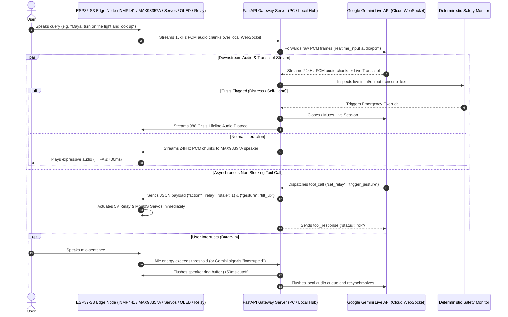

# 🌸 MAYA: Gemini Live API Integration Plan & Workflow
### Native Speech-to-Speech Architecture for ESP32-S3 IoT Tabletop Robot & Gateway

---

## 1. Executive Summary

This document specifies the technical design, system workflow, and phased implementation plan for upgrading **MAYA** from a cascaded pipeline (`WebRTC VAD ➔ Groq Whisper ➔ Gemini/Groq LLM ➔ Edge-TTS`) to Google's **Gemini Live API** native **Speech-to-Speech (S2S)** architecture.

### Objectives
1. **Slash Turn Latency:** Drop Time-To-First-Audio (TTFA) from ~800–1000ms down to **~300–450ms**.
2. **Empathetic Emotional Prosody:** Replace flat synthetic TTS with Gemini's expressive, emotionally dynamic vocal inflections (laughter, whispers, thoughtful pauses).
3. **Non-Blocking IoT Actuation:** Execute physical robot actions (servo neck gestures, OLED eye animations, 5V appliance relay switching) concurrently while speaking without interrupting conversational flow.
4. **Zero-Latency Safety Preservation:** Maintain MAYA's deterministic mental health crisis guardrails by monitoring the real-time transcription stream and overriding audio when distress keywords are detected.
5. **Dual-Mode Architecture:** Provide a configuration toggle (`VOICE_ENGINE: "gemini_live" | "cascaded"`) allowing instant fallback to the existing Groq Whisper + Edge-TTS pipeline for Bangla language mode or offline resilience.

---

## 2. End-to-End System Workflow



---

## 3. System Architecture & Topology

The implementation leverages MAYA's **Edge-Gateway-Cloud Hybrid Topology**. The resource-constrained ESP32-S3 handles real-time audio I/O and hardware PWM/GPIO actuation, while the FastAPI Gateway manages cloud authentication, audio format conversion, safety oversight, and tool dispatch.

```
┌─────────────────────────────────────────────────────────────────────────────┐
│                       ESP32-S3 TABLETOP ROBOT BODY                          │
│                                                                             │
│  [INMP441 MEMS Mic]       ──► I2S DMA Rx (16kHz, 16-bit Mono)               │
│  [MAX98357A 3.2W Amp]     ◄── I2S DMA Tx (24kHz, 16-bit Mono)               │
│  [2× MG90S Servos]        ◄── Direct LEDC PWM (GPIO 13 Yaw / GPIO 14 Pitch) │
│  [0.96" SSD1306 OLED]     ◄── I2C Framebuffer (GPIO 8 SDA / GPIO 9 SCL)     │
│  [1-Ch 5V Opto Relay]     ◄── GPIO 21 Digital Out                           │
│                               ▲                                             │
└───────────────────────────────┼─────────────────────────────────────────────┘
                                │ Bidirectional Local Wi-Fi WebSocket
                                │ (Opcode Binary: Raw Audio | Opcode Text: JSON)
                                ▼
┌─────────────────────────────────────────────────────────────────────────────┐
│                         FASTAPI GATEWAY SERVER                              │
│                                                                             │
│  ┌────────────────────────┐  ┌───────────────────────────────────────────┐  │
│  │ Local Audio Bridge     │  │ Tool Dispatcher & Robot Controller        │  │
│  │ • Echo Gating / Ducking│  │ • set_relay(device, state)                │  │
│  │ • Buffer Flush Cutoff  │  │ • set_neck_gesture(gesture, speed)        │  │
│  │ • Sample Rate Handling │  │ • set_facial_expression(emotion)          │  │
│  └───────────┬────────────┘  └─────────────────────┬─────────────────────┘  │
│              │                                     │                        │
│  ┌───────────▼─────────────────────────────────────▼─────────────────────┐  │
│  │ Gemini Live Engine (google-genai SDK Async Session Manager)           │  │
│  │ • Persistent TLS WebSocket connection                                 │  │
│  │ • Asynchronous Non-Blocking Tool Calling                              │  │
│  │ • Barge-In Event Handler (server_content.interrupted)                 │  │
│  │ • Real-Time Input/Output Transcript Tap for Safety & Memory           │  │
│  └───────────────────────────────────┬───────────────────────────────────┘  │
└──────────────────────────────────────┼──────────────────────────────────────┘
                                       │ Bidirectional Google Cloud WSS
                                       ▼
┌─────────────────────────────────────────────────────────────────────────────┐
│                         GOOGLE GEMINI LIVE API                              │
│               Model: gemini-2.0-flash-realtime / gemini-3.8-live             │
│        Response Modalities: ["AUDIO"] | Voice: "Zephyr" / "Aoede"           │
└─────────────────────────────────────────────────────────────────────────────┘
```

---

## 4. Phased Implementation Plan

### Phase 1: Gateway Live Session Engine & Worker Architecture
**Target:** Create a dedicated, resilient Live API bridge inside MAYA's server framework.
* **File:** `server/app/pipeline/live_brain.py`
* **Tasks:**
  1. Initialize `genai.Client(api_key=settings.GEMINI_API_KEY)` using the official `google-genai` Python SDK.
  2. Implement `LiveConnectConfig`:
     - `response_modalities=["AUDIO"]`.
     - `speech_config` targeting low-pitch, warm voice profiles (e.g., `"Zephyr"`, `"Aoede"`, or `"Kore"`).
     - Enable `input_audio_transcription` and `output_audio_transcription` for real-time text tapping.
  3. Structure the **4-Worker Concurrency Pattern**:
     - `send_audio()`: Streams incoming 16kHz PCM chunks to Gemini over `session.send_realtime_input()`.
     - `receive_audio()`: Receives downstream audio chunks, detects `server_content.interrupted`, and pushes PCM bytes to the outbound playback queue.
     - `dispatch_tools()`: Listens for `server_content.model_turn.parts` containing function calls and executes them asynchronously.
     - `transcript_monitor()`: Collects transcription text and feeds it into the tiered memory and crisis safety evaluators.

### Phase 2: Acoustic Feedback Protection & Echo Cancellation
**Target:** Prevent the tabletop robot's microphone from capturing its own speaker output.
* **Tasks:**
  1. **Software Ducking / Echo Gating:** Implement a dynamic software gate in the Gateway. When downstream audio is actively being transmitted to the ESP32 speaker, attenuate upstream microphone sensitivity or temporarily mute upstream chunks unless the audio energy spikes past `BARGE_IN_RMS_THRESHOLD` (indicating real human barge-in).
  2. **Hardware Ring Buffer Flush:** On receiving `server_content.interrupted`, send an immediate single-byte control frame (`0xFF` / `CLEAR_BUFFER`) to the ESP32-S3 to clear the I2S DMA transmit ring buffer within `< 30ms`.

### Phase 3: Tool Declarations for IoT & Tabletop Robotics
**Target:** Give Gemini direct, conversational control over physical robot actuators.
* **Declared Function Schemas:**
  ```python
  relay_tool = {
      "name": "control_appliance",
      "description": "Switch physical appliances (light, fan) connected to the relay.",
      "parameters": {
          "type": "object",
          "properties": {
              "appliance": {"type": "string", "enum": ["light", "fan", "relay"]},
              "state": {"type": "string", "enum": ["on", "off"]}
          },
          "required": ["appliance", "state"]
      }
  }

  gesture_tool = {
      "name": "trigger_head_gesture",
      "description": "Animate physical robot head servos for expressive gestures.",
      "parameters": {
          "type": "object",
          "properties": {
              "gesture": {"type": "string", "enum": ["nod_yes", "shake_no", "cock_curious", "center", "look_up"]}
          },
          "required": ["gesture"]
      }
  }

  expression_tool = {
      "name": "set_facial_expression",
      "description": "Set dynamic animated eye expression on the OLED screen.",
      "parameters": {
          "type": "object",
          "properties": {
              "expression": {"type": "string", "enum": ["happy", "blinking", "listening", "curious", "sleeping"]}
          },
          "required": ["expression"]
      }
  }
  ```
* **Execution Path:** The Gateway maps function calls to lightweight JSON events dispatched over the existing ESP32 WebSocket channel:
  `{"action": "servo", "gesture": "nod_yes"}` or `{"action": "relay", "state": 1}`.

### Phase 4: Deterministic Crisis Guardrail Adaptation
**Target:** Safeguard mental health interactions without sacrificing low latency.
* **Challenge:** In native S2S, the model speaks directly from audio tokens without waiting for a completed text transcript.
* **Safety Mechanism:**
  1. The Gateway subscribes to the live `input_audio_transcription` stream.
  2. The text is passed chunk-by-chunk to MAYA's [safety.py](file:///D:/MAYA/maya-multilingual-voice-iot/server/app/pipeline/safety.py) evaluator in real-time.
  3. If high-risk suicidal ideation or self-harm keywords match, the Gateway immediately:
     - Issues a session cancellation to Gemini.
     - Sends an abort signal to the robot speaker.
     - Injects a pre-rendered, calming 988 emergency audio announcement directly to the speaker.

### Phase 5: ESP32-S3 Firmware Configuration & Dual I2S
**Target:** Ensure smooth 16kHz capture and 24kHz playback over Wi-Fi.
* **Firmware Setup:**
  * **Core 0:** FreeRTOS WebSocket Client Task handling binary audio frames and JSON tool commands.
  * **Core 1:** Audio I2S DMA Engine + LEDC Servo PWM.
  * **Audio Clocks:**
    * INMP441 Input: 16 kHz sample rate, 16-bit, Mono ($I^2S$ Port 0).
    * MAX98357A Output: 24 kHz sample rate, 16-bit, Mono ($I^2S$ Port 1).
  * **Servo Smoothness:** Use FreeRTOS software interpolation tasks to prevent sudden jerky movements when `trigger_head_gesture` is invoked.

### Phase 6: Dual-Engine Configuration Toggle & Resilient Fallback
**Target:** Allow seamless toggling between Gemini Live and MAYA's existing cascaded pipeline.
* **Configuration:** Add `VOICE_ENGINE: "gemini_live" | "cascaded"` to `Settings` in [config.py](file:///D:/MAYA/maya-multilingual-voice-iot/server/app/config.py).
* **Automatic Fallback:** If Gemini Live fails to establish a WebSocket handshake (network drop, API quota), the gateway transparently switches to the Groq Whisper + Edge-TTS pipeline.

---

## 5. Verification & Testing Matrix

| Test Case | Procedure | Acceptance Criteria |
| :--- | :--- | :--- |
| **1. Audio Handshake & Latency** | Speak simple query (*"What time is it?"*) | TTFA response starts playing on robot speaker within **≤ 450ms**. |
| **2. Physical Tool Execution** | Command: *"Turn on the desk light and nod your head"* | Relay clicks and neck servos nod while Gemini speaks confirmation in parallel. |
| **3. Acoustic Barge-In** | User speaks loudly while MAYA is in mid-speech | Robot audio cuts off in **< 50ms** and assistant switches to listening. |
| **4. Echo Prevention** | MAYA speaks continuous story for 10 seconds | Assistant finishes speaking without self-triggering or cutting off. |
| **5. Crisis Safety Tripwire** | Inject crisis utterance (*"I feel like ending it all"*) | Live session aborts; deterministic 988 emergency protocol plays cleanly. |
| **6. Failover Resilience** | Simulate cloud WebSocket disconnect | Gateway falls back to Groq Whisper + Edge-TTS with `< 1s` glitch. |

---

## 6. Implementation Task Roadmap

- [ ] **Step 1:** Add `gemini-live` dependencies (`google-genai>=0.1.1`) and environment flags in `server/.env` and `config.py`.
- [ ] **Step 2:** Build `server/app/pipeline/live_brain.py` with the 4-worker async loop and tool handlers.
- [ ] **Step 3:** Implement the Gateway WebSocket router supporting dual binary audio frames (16kHz in / 24kHz out) and JSON tool control.
- [ ] **Step 4:** Integrate the real-time transcript safety interceptor linking `live_brain.py` to `safety.py`.
- [ ] **Step 5:** Flash ESP32-S3 firmware with dual I2S clocks (16kHz mic, 24kHz speaker) and test Pan-Tilt servo commands.
- [ ] **Step 6:** Run end-to-end latency and acoustic barge-in calibration on physical robot hardware.
